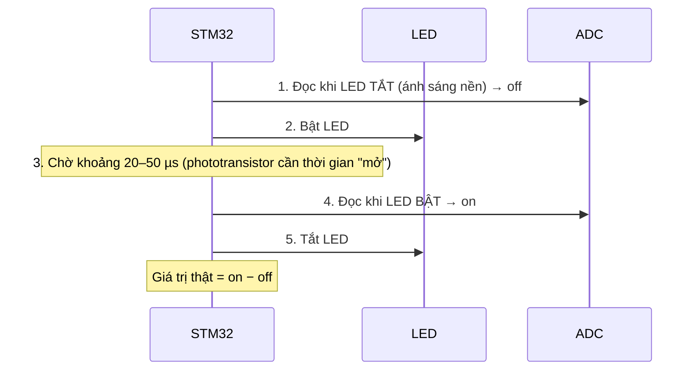

# Tự làm cảm biến tường hồng ngoại (IR) cho Micromouse

## 1. Nguyên lý

Mỗi "cảm biến" thật ra là **một cặp linh kiện đặt cạnh nhau, cùng hướng về phía tường**:

```
   Robot                          Tường trắng
  ┌──────┐   LED IR  ─────────►   ┃
  │      │                        ┃  (ánh sáng dội lại)
  │      │   Phototransistor ◄─── ┃
  └──────┘
```

- **LED IR (bộ phát):** phát ánh sáng hồng ngoại 940 nm. Mắt người không thấy, nhưng camera điện thoại thì thấy.
- **Phototransistor (bộ thu):** giống một "van" điện. Càng nhận nhiều ánh sáng IR thì dòng chạy qua nó càng lớn, nên điện áp ra càng cao.
- **Tường càng gần → ánh sáng dội về càng nhiều → điện áp càng cao.** Vi điều khiển đọc điện áp này bằng **ADC** (giá trị từ 0 đến 4095 trên STM32).

> [!NOTE]
> Giá trị đọc được **không tỉ lệ thẳng** với khoảng cách. Nó giảm rất nhanh khi tường ra xa, xấp xỉ theo 1/d². Vì vậy cảm biến rất nhạy ở gần (20–60 mm), đúng khoảng cách hay gặp trong sân half-size.

---

## 2. Sơ đồ mạch cho MỘT cặp

Mạch gồm hai nửa độc lập: **mạch phát** (bật/tắt LED) và **mạch thu** (đọc ánh sáng).

```
        MẠCH PHÁT                               MẠCH THU

   +5V ───┬────────                     +3.3V ───────
          │                                    │
       [ R1 47Ω ]   ← giới hạn dòng LED        │ C (chân dài hoặc chân phẳng: xem datasheet)
          │                              ┌─────┴─────┐
        ──┴──                            │ Phototran- │  ← chiếu ánh sáng vào đây
        \ ▼ /  LED IR 940nm              │  sistor    │
        ──┬──                            └─────┬─────┘
          │                                    │ E
          │ D                                  ├──────────► tới chân ADC của STM32 (vd PA0)
  GPIO ──┤│  MOSFET N (AO3400)                 │
 (vd PB12)│ G                               [ R2 4.7kΩ ]  ← "độ nhạy"
          │ S                                  │
   GND ───┴────────                     GND ───┴──────
         (thêm R 10kΩ từ G xuống GND để LED tắt khi mới khởi động)
```

### Mạch phát hoạt động thế nào?
- MOSFET đóng vai trò **công tắc điện tử**: chân GPIO lên mức 1 (3,3 V) thì MOSFET dẫn và LED sáng. GPIO về 0 thì LED tắt.
- Phải dùng MOSFET vì **chân STM32 chỉ cấp được khoảng 20 mA**, trong khi LED IR cần khoảng 50–100 mA mới chiếu đủ mạnh.
- **R1** giới hạn dòng qua LED:

$$I_{LED} = \frac{V_{cc} - V_{LED}}{R_1} = \frac{5 - 1.4}{47} \approx 77\ \text{mA}$$

  LED chỉ sáng trong vài chục µs mỗi lần đọc nên không bị nóng. Có thể bắt đầu với 47–68 Ω rồi chỉnh sau.

### Mạch thu hoạt động thế nào?
- Phototransistor và **R2** tạo thành một **cầu phân áp**. Phototransistor nhận nhiều sáng thì dòng lớn, điện áp rơi trên R2 lớn, nên điện áp ở chân ADC cao.
- **R2 quyết định độ nhạy:**
  - R2 lớn (10 kΩ): nhạy, nhìn được tường xa, nhưng **bị bão hòa** (kẹt ở 3,3 V) khi tường gần.
  - R2 nhỏ (1 kΩ): kém nhạy, nhưng không bão hòa khi tường gần.
  - Bắt đầu với **4,7 kΩ** rồi chỉnh sao cho khi tường sát nhất, giá trị ADC vẫn **chưa chạm 4095**.
- Mạch thu cấp **3,3 V** để điện áp ra không bao giờ vượt quá 3,3 V. Đây là giới hạn của chân ADC STM32, cấp 5 V có thể làm hỏng chip.

> [!TIP]
> Nếu thấy MOSFET dán (SMD) khó hàn, có thể thay bằng **transistor NPN chân cắm S8050 hoặc 2N2222**: nối GPIO vào chân B qua điện trở 1 kΩ, chân E xuống GND, chân C nối vào LED. Hoạt động y hệt.

---

## 3. Nhận Diện Chân Thực Tế & Danh Sách Linh Kiện Chuẩn Của Nhóm (`IR333-A` + `PT334-6B`)

> [!CAUTION]
> **LƯU Ý SỐNG CÒN ĐỂ KHÔNG CẮM NGƯỢC:**
> Bóng phát **`IR333-A` (vỏ trong xanh nhạt)** và bóng thu **`PT334-6B` (vỏ đen tuyền)** có quy ước chân Dài / Ngắn **NGƯỢC NHAU HOÀN TOÀN**!
> - **Bóng phát `IR333-A` (vỏ trong xanh):** Chân **DÀI = Anode `(+)`** (nối vào trở `47 Ω` lên `+5V`), Chân **NGẮN (vát phẳng) = Cathode `(-)`** (gom về cực `C` của `Q1/Q2`).
> - **Bóng thu `PT334-6B` (vỏ ĐEN tuyền):** Chân **NGẮN (vát phẳng) = Collector (`C`, nối thẳng lên `+3.3V`)**, còn Chân **DÀI = Emitter (`E`, nối vào ngã ba ra chân `ADC` `PA0..PA3` và trở `4.7 kΩ` xuống `GND`)**!

```text
  1. BÓNG PHÁT IR333-A (940nm)          2. BÓNG THU PT334-6B (940nm)          3. TRANSISTOR NPN S8050 (TO-92)
   (Vỏ nhựa TRONG XANH NHẠT)              (Vỏ nhựa ĐEN TUYỀN lọc sáng)         (Mặt phẳng có chữ quay vào mắt)
       ┌───────────────┐                      ┌───────────────┐                       ┌───────────┐
      /   Chỏm tròn     \                    /   Chỏm tròn     \                      │   S8050   │
     │  (Ánh hồng ngoại) │                  │  (Nhận phản xạ)   │                     │ (NPN BJT) │
     └─┬───────────────┬─┘◄─ Vát phẳng      └─┬───────────────┬─┘◄─ Vát phẳng         └─┬───┬───┬─┘
       │               │     (Cathode -)      │               │     (Collector +)       │   │   │
       │ Chân DÀI      │ Chân NGẮN            │ Chân DÀI      │ Chân NGẮN              (1) (2) (3)
       │ = ANODE (+)   │ = CATHODE (-)        │ = EMITTER (E) │ = COLLECTOR (C)         E   B   C
       ▼               ▼                      ▼               ▼                         ▼   ▼   ▼
   Nối qua trở     Gom về chân C          Nối ra chân ADC   BẮT BUỘC nối            Nối   Qua   Gom chân
   47Ω (R1..R4)    của Q1 (PB12)          (PA0..PA3) VÀ     lên nguồn               xuống R9/   Ngắn (-)
   lên +5.0V       hoặc Q2 (PB13)         trở 4.7kΩ (R5..8) +3.3V!                  GND   R10   của 2 bóng
                                          xuống GND                                       (100Ω) phát IR
```

| Linh kiện | Số lượng | Ký hiệu trên Mạch | Mã linh kiện đã chốt của nhóm | Nhiệm vụ & Đấu nối |
|---|---|---|---|---|
| **Bóng phát IR `940 nm`** | 4 (+6 dự phòng) | `IR_FL, IR_DL, IR_DR, IR_FR` (bên trái) | **`IR333-A`** (`Ø5 mm` vỏ trong xanh) | Chân Dài `(+)` qua trở `47 Ω` (`R1..R4`) lên `+5.0V`; Chân Ngắn `(-)` về `Q1` hoặc `Q2` |
| **Bóng thu IR `940 nm`** | 4 (+6 dự phòng) | `IR_FL, IR_DL, IR_DR, IR_FR` (bên phải) | **`PT334-6B`** (`Ø5 mm` vỏ đen tuyền) | Chân Ngắn (`C`) lên `+3.3V`; Chân Dài (`E`) ra `PA0..PA3` và qua trở `4.7 kΩ` (`R5..R8`) xuống `GND` |
| **Trở hạn dòng phát** | 4 | **`R1, R2, R3, R4`** | **`47 Ω`** `1/4W 1%` (*Vàng-Tím-Đen*) / SMD `470` | Hạn dòng xung phát `~76 mA` cho từng bóng `IR333-A` |
| **Trở tải mạch thu** | 4 | **`R5, R6, R7, R8`** | **`4.7 kΩ`** `1/4W 1%` (*Vàng-Tím-Đỏ*) / SMD `472` | Chuyển dòng quang điện thành áp Analog `0..3.3V` đưa về `PA0, PA1, PA2, PA3` |
| **Khóa chuyển mạch phát** | 2 | **`Q1`** (Trước), **`Q2`** (Chéo) | **`S8050`** (`TO-92` cắm) / **`AO3400`** (`SOT-23` dán) | `Q1` bật/tắt 2 mắt Trước (`FL+FR`); `Q2` bật/tắt 2 mắt Chéo (`DL+DR`) |
| **Trở kích cực Base/Gate** | 2 | **`R9`** (`PB12`), **`R10`** (`PB13`) | **`100 Ω`** `1/4W 1%` (*Nâu-Đen-Nâu*) / SMD `101` | Nối từ `PB12` vào cực `B/G` của `Q1` và từ `PB13` vào cực `B/G` của `Q2` |
| **Ống co nhiệt đen** | 1 đoạn | — | **`Ø5 mm` màu đen mờ** | Cắt `6 mm` bọc thân bóng phát `IR333-A`; cắt `8 mm` bọc nhô quá đỉnh bóng thu `PT334-6B` `1 mm` |

---

## 4. Bố trí trên robot

```
              Hướng chạy ▲
         FL ↑            ↑ FR        FL/FR: chiếu thẳng phía trước → phát hiện tường trước mặt
             ╲          ╱
         DL ↖  ┌──────┐  ↗ DR        DL/DR: chiếu chéo khoảng 45° → nhìn tường trái/phải
               │ROBOT │                      để biết có tường và giữ robot ở giữa hành lang
               │ ●  ● │ ← bánh
               └──────┘
```

- **Độ cao:** LED và phototransistor cách sàn **khoảng 8–15 mm**, vì tường chỉ cao 20 mm.
- **Chống "rò sáng":** **bọc ống co nhiệt đen quanh từng LED và từng phototransistor**. Nếu không, ánh sáng từ LED đi thẳng sang bộ thu bên cạnh mà không cần dội vào tường, khiến cảm biến luôn báo "có tường". Đây là lỗi người mới hay gặp nhất.
- Mỗi cặp LED và bộ thu đặt **song song, cách nhau khoảng 5–10 mm, cùng hướng**.
- Có thể **bẻ chân LED để chỉnh góc** trong quá trình thử nghiệm, sau đó cố định bằng keo nến.

**Số MOSFET cần dùng:** dùng 2 nhóm là đủ, một nhóm cho 2 LED trước (FL+FR) và một nhóm cho 2 LED chéo (DL+DR). Bật lần lượt từng nhóm để tránh nhiễu chéo, tổng cộng chỉ tốn 2 chân GPIO.

---

## 5. Khử ánh sáng môi trường

Đèn phòng và ánh nắng cũng chứa hồng ngoại, nên phototransistor luôn nhận một chút ánh sáng nền. Cách khử:



Phép trừ `on − off` loại bỏ phần ánh sáng phòng, chỉ giữ lại ánh sáng **do LED của robot tạo ra**.

---

## 6. Code Arduino IDE (`STM32duino`) Mẫu — Đọc Cảm Biến & Khử Nhiễu Đèn Phòng

Trên **Arduino IDE**, bạn không cần cấu hình thanh ghi ADC hay bộ đếm `DWT` phức tạp như `STM32 HAL`. Chỉ cần bật `analogReadResolution(12)` trong `setup()` và dùng `digitalWrite()`, `delayMicroseconds(60)`, `analogRead()` cực kỳ dễ hiểu:

```cpp
#include <Arduino.h>

#if !defined(ARDUINO_BLACKPILL_F411CE)
  #error "Ban chua chon BlackPill F411CE! Hay vao menu Tools -> Board part number -> chon BlackPill F411CE"
#endif

// Chân điều khiển 2 nhánh MOSFET phát hồng ngoại
#define PIN_IR_PHAT_TRUOC       PB12  // Bật/tắt 2 đèn IR Trước (FL + FR)
#define PIN_IR_PHAT_CHEO        PB13  // Bật/tắt 2 đèn IR Chéo  (DL + DR)

// Chân đọc 4 bóng thu Phototransistor PT334-6B (khớp với bảng nối dây Breadboard & PCB)
#define PIN_IR_THU_TRUOC_TRAI   PA0   // Mắt Trước Trái (FL)
#define PIN_IR_THU_CHEO_TRAI    PA1   // Mắt Chéo Trái  (DL)
#define PIN_IR_THU_CHEO_PHAI    PA2   // Mắt Chéo Phải  (DR)
#define PIN_IR_THU_TRUOC_PHAI   PA3   // Mắt Trước Phải (FR)

// 4 biến lưu độ mạnh phản xạ của tường (từ 0 đến 4095)
int s_fl = 0, s_dl = 0, s_dr = 0, s_fr = 0;

void doc4MatIR() {
    // --- 1. Nhóm 2 mắt TRƯỚC (FL và FR) ---
    // Bước 1a: Đọc ánh sáng phòng khi đèn IR đang TẮT
    int fl_off = analogRead(PIN_IR_THU_TRUOC_TRAI);
    int fr_off = analogRead(PIN_IR_THU_TRUOC_PHAI);

    // Bước 1b: Bật đèn IR Trước, chờ 60 micro-giây cho PT334-6B ổn định rồi đọc lại
    digitalWrite(PIN_IR_PHAT_TRUOC, HIGH);
    delayMicroseconds(60);
    int fl_on = analogRead(PIN_IR_THU_TRUOC_TRAI);
    int fr_on = analogRead(PIN_IR_THU_TRUOC_PHAI);
    digitalWrite(PIN_IR_PHAT_TRUOC, LOW); // Tắt đèn ngay để bóng phát luôn mát!

    // Bước 1c: Lấy (Khi Bật - Khi Tắt) để loại bỏ hoàn toàn ánh sáng đèn hội trường
    s_fl = max(0, fl_on - fl_off);
    s_fr = max(0, fr_on - fr_off);

    // --- 2. Nhóm 2 mắt CHÉO (DL và DR) ---
    int dl_off = analogRead(PIN_IR_THU_CHEO_TRAI);
    int dr_off = analogRead(PIN_IR_THU_CHEO_PHAI);

    digitalWrite(PIN_IR_PHAT_CHEO, HIGH);
    delayMicroseconds(60);
    int dl_on = analogRead(PIN_IR_THU_CHEO_TRAI);
    int dr_on = analogRead(PIN_IR_THU_CHEO_PHAI);
    digitalWrite(PIN_IR_PHAT_CHEO, LOW);

    s_dl = max(0, dl_on - dl_off);
    s_dr = max(0, dr_on - dr_off);
}

void setup() {
    Serial.begin(115200);
    analogReadResolution(12); // Đọc ADC độ phân giải 12-bit (0 -> 4095) của STM32F411

    pinMode(PIN_IR_PHAT_TRUOC, OUTPUT);
    pinMode(PIN_IR_PHAT_CHEO,  OUTPUT);
    digitalWrite(PIN_IR_PHAT_TRUOC, LOW);
    digitalWrite(PIN_IR_PHAT_CHEO,  LOW);
}

void loop() {
    doc4MatIR();

    // In ra Serial Monitor (hoặc Serial Plotter) mỗi 100 ms để xem số đo thực tế
    Serial.print("FL:"); Serial.print(s_fl);
    Serial.print("\tDL:"); Serial.print(s_dl);
    Serial.print("\tDR:"); Serial.print(s_dr);
    Serial.print("\tFR:"); Serial.println(s_fr);
    delay(100);
}
```

---

## 7. Hiệu chuẩn và sử dụng giữ thẳng xe giữa hành lang

**Bước hiệu chuẩn** (mở **Serial Monitor** trên Arduino IDE qua cáp USB-C):
1. Đặt robot **chính giữa một ô có đủ tường hai bên**, ghi lại giá trị `s_dl` và `s_dr` hiển thị trên màn hình làm mốc `DL_CENTER` và `DR_CENTER`.
2. Đặt robot ở giữa ô, **có tường phía trước**, ghi lại giá trị `s_fl`/`s_fr`. Từ đó suy ra ngưỡng "có tường phía trước".
3. Cho robot **không có tường hai bên**, ghi lại giá trị. Ngưỡng "có tường" nên đặt khoảng **một nửa** giá trị ở bước 1.

**Dùng trong code Arduino IDE:**

```cpp
const int DL_CENTER     = 850;    // Giá trị ví dụ khi xe đứng chính giữa ô, thay bằng số đo thật
const int DR_CENTER     = 820;
const int WALL_TH_SIDE  = 400;    // Ngưỡng nhận biết có tường Trái / Phải
const int WALL_TH_FRONT = 300;    // Ngưỡng nhận biết có tường Trước
const float KP_WALL     = 0.08f;  // Hệ số tỉ lệ P để lái xe bám giữa hành lang

bool coTuongTrai  = (s_dl > WALL_TH_SIDE);
bool coTuongPhai  = (s_dr > WALL_TH_SIDE);
bool coTuongTruoc = ((s_fl + s_fr) / 2 > WALL_TH_FRONT);

// Tính độ lệch khỏi tâm hành lang (error > 0: xe đang lệch sang trái, cần đánh lái sang phải)
int saiSoGiuaDuong = 0;
if (coTuongTrai && coTuongPhai) {
    saiSoGiuaDuong = (s_dl - DL_CENTER) - (s_dr - DR_CENTER);
} else if (coTuongTrai) {
    saiSoGiuaDuong = 2 * (s_dl - DL_CENTER);
} else if (coTuongPhai) {
    saiSoGiuaDuong = -2 * (s_dr - DR_CENTER);
}

int luongBeLai = (int)(KP_WALL * saiSoGiuaDuong);
// Cộng/trừ vào tốc độ cơ bản (ví dụ tocDoCoBan = 110):
// dieuKhienMotor(tocDoCoBan + luongBeLai, tocDoCoBan - luongBeLai);
```

> [!IMPORTANT]
> Ánh sáng và độ phản xạ ở mỗi sân sẽ khác nhau. Hãy làm một **mode hiệu chuẩn** chọn bằng DIP switch, lưu kết quả vào Flash. Theo thể lệ, việc này hợp lệ vì nó thuộc nhóm "chức năng có sẵn trên robot".

---

## 8. Thử nghiệm trên breadboard (làm được ngay tuần này)

1. **Kiểm tra LED:** cấp nguồn 5 V qua R1 cho LED rồi nhìn qua **camera điện thoại**. Thấy chấm tím sáng là LED hoạt động. *(Một số camera trước của iPhone lọc IR, nên dùng camera sau.)*
2. **Kiểm tra bộ thu:** lắp mạch thu, đo điện áp ở điểm nối E–R2 bằng **đồng hồ vạn năng**, rồi đưa tấm giấy trắng lại gần cặp LED + bộ thu. Điện áp tăng dần khi giấy lại gần là đúng.
3. **Thử với tường thật:** dựng một tấm nhựa hoặc bìa trắng cao 20 mm, đo giá trị ở các khoảng cách 10, 20, 30 ... 100 mm, ghi vào Excel và vẽ đồ thị. Bạn sẽ thấy rõ đường cong 1/d².
4. **Thử R2 khác nhau** (1k, 4,7k, 10k) để chọn giá trị cho dải đo đẹp nhất trong khoảng 20–90 mm.
5. Sau đó mới nối vào STM32 và chạy code ở mục 6.

> [!NOTE]
> Mạch này cùng nguyên lý với board `wall-sensor-basic` của UKMARSBOT (`hardware/wall-sensors/` trong repo). Có thể mở file sơ đồ PDF trong đó để so sánh.
