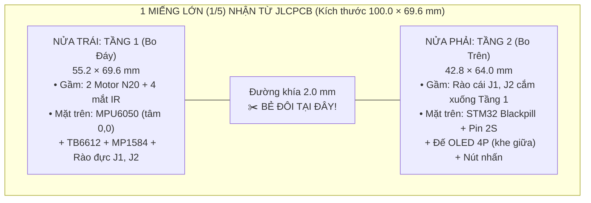

# Sổ Tay Chế Tạo Thực Tế Half-Size Micromouse (Breadboard → Perfboard → PCB 2 Tầng)

Tài liệu tinh gọn tập trung 100% vào thiết kế đã chốt của nhóm cho giải **BEST PROJECT 2026 – Bảng Đại Học (ĐH Bách Khoa Hà Nội)**: **`STM32F411 Blackpill` lập trình trên Arduino IDE + 2× Motor `N20 6V 500RPM` + `MPU6050` + 4 mắt `DIY IR` + Màn hình `OLED I2C`**.

---

## 1. Chiến Thuật Chạy Thi Đấu & Quy Tắc Chống Đi Xuyên Tường

### 1.1. Khi đến Đích ở Lượt 1: Lưu Flash ngay & Nhặt xe về vạch xuất phát
Theo **Trang 5 – Mục 4.3 Thể lệ BTC**: *"Khi hoàn thành một lượt chạy, robot có thể tự quay về vị trí xuất phát HOẶC được thành viên trong đội mang về vị trí xuất phát, đây không được coi là 1 lần can thiệp."*
1. Ngay khoảnh khắc xe cán vào 1 trong 4 ô Đích `(7,7), (7,8), (8,7), (8,8)`: phanh dừng xe $\rightarrow$ gọi hàm **`luuBanDoVaoFlash()`** $\rightarrow$ hiện chữ **`"MAP SAVED!"`** lên màn hình OLED và kêu còi Buzzer báo trọng tài.
2. Nhặt tay mang xe về lại `(0,0)` (hoàn toàn hợp lệ, **không bị tính là can thiệp**), có thể tắt nguồn lau sạch bụi bánh xe Silicone (Mục 4.2), gạt DIP Switch sang chế độ **Speed Run** rồi bấm `START`.

### 1.2. Quy tắc vàng chống lỗi "đi xuyên tường" ở Lượt 2 (Speed Run)
> [!IMPORTANT]
> **Bắt buộc lưu cả 2 mảng `tuongMeCung[16][16]` VÀ `oDaDiQua[16][16]` (`visited`) vào Flash!**
> - **Ở Lượt 1 (Search Run):** Cho phép thuật toán Floodfill đi vào các ô chưa khám phá (`oDaDiQua == 0`) để mở bản đồ.
> - **Ở Lượt 2 (Speed Run):** Bắt buộc **khóa cứng mọi ô có `oDaDiQua[hang][cot] == 0`** (coi như ô bị bịt kín 4 hướng), chỉ cho phép xe chạy tốc độ cao bên trong các hành lang đã được mắt IR xác thực 100% ở Lượt 1!

---

## 2. Cơ Khí 2 Tầng, Tích Hợp Màn Hình `OLED I2C` & Giải Đáp Cách In PCB 2 Tầng

### 2.1. Bảng thông số lắp ghép cơ khí thực tế (Gá ốc M2, Mối hàn & Dây điện)

| Thành phần thực tế | Kích thước thật | Lưu ý lắp ráp bắt buộc để không cấn / không chạm chập |
| :--- | :--- | :--- |
| **Gá nhựa trắng N20 (Hshop)** | Rộng **`25.4 mm`** (tâm 2 lỗ ốc cách `18.0 mm`), cao `11.4 mm` | Đặt 2 trục motor lệch nhau **`Δz = 15.0 mm`** (`z = ±7.5 mm`), mặt hộp số ở `x = ±22.0 mm` để toàn bộ tai gá nằm gọn dưới Tầng 1 |
| **Mối hàn xuyên lỗ & Lưng sắt Motor** | Mối hàn nhọn xuống gầm `1.0 – 1.5 mm` | **(1)** Đệm **long-đen nhựa M2 dày `1.5 mm`** giữa đỉnh gá motor và gầm Tầng 1; **(2)** Dán **1 lớp băng dính cách điện Kapton** lên lưng sắt 2 motor N20 |
| **2 bộ cáp Motor + Encoder (12 sợi)** | Cáp zin dài `15 cm` | Cắt ngắn còn **`4.5 – 5.5 cm`**, luồn qua **2 khe chữ nhật `3.2 × 5.8 mm`** khoét sẵn trên Tầng 1 (`x = ±13.0 mm, z = ∓9.5 mm`) lên cắm vào header `2×3` mặt trên Tầng 1 |
| **Dây nguồn chính trên mạch** | Dòng tiêu thụ `~0.4 – 1.8 A` | **Lưu ý về dây `AWG18` trong danh sách đồ:** Dây `18AWG` lõi đồng rất to (`Ø1.02 mm`) dùng nối từ giắc Pin 2S ra công tắc thì tốt, nhưng sẽ **không xỏ lọt lỗ chân `MP1584`/`TB6612` (`Ø0.9 mm`)**. Các đoạn nối nguồn ngắn trên mạch bạn nên dùng dây **`22AWG` hoặc `24AWG`** (hoặc chập đôi 2 sợi dây Dupont) sẽ mềm và vừa lỗ hàn hơn rất nhiều! |

---

### 2.2. Cách Gắn Màn Hình `OLED I2C` Khi Mặt Tầng 2 Đã Kín Chỗ (`Bridge HUD 4 Chân` Hoặc `Dây Bus Rời`)

Bạn nhìn rất chuẩn: Trên mặt Tầng 2 (`42.8 × 64.0 mm`), nửa trái đã cắm `STM32 Blackpill` còn nửa phải đã đặt viên `Pin LiPo 2S`, vậy gắn `OLED I2C` vào đâu để không cấn?
Chúng ta tận dụng **khe trống rộng `4.6 mm` chạy dọc chính giữa Tầng 2 (`x = +2.1 mm`)** nằm giữa hàng rào cái bên phải của `Blackpill` (`x = -0.93 mm`) và mép trái viên `Pin LiPo 2S` (`x = +3.70 mm`) theo **2 cách cực kỳ gọn**:

1. **Cách 1 — Đế Cắm "Cầu Vượt" 4 Chân (`1×4 Tall Female Header` — Đã dựng trực tiếp trên Mô Phỏng 3D):**
   - Một thanh rào cái 4 chân (`1×4 Female Header`) chỉ rộng đúng **`2.5 mm × 10.2 mm`** nhưng cao **`9.2 mm`** (cao hơn cả viên Pin `8.0 mm` lẫn `Blackpill` `6.5 mm`!).
   - Bạn hàn thanh rào cái 4 chân này стоя (đứng thẳng) vào đúng khe trống `4.6 mm` ở giữa Tầng 2 (`x = +2.1 mm, z = -4.0 mm`), nối 4 chân dưới gầm vào `GND - 3.3V - PB8(SCL) - PB9(SDA)`.
   - Khi cắm màn hình **`OLED I2C` (`0.91"` hoặc `0.96"`)** lên đỉnh thanh rào cái này, màn hình sẽ **nằm nổi lơ lửng cao hơn mặt Pin và Blackpill `~2.0 mm` giống hệt một chiếc cầu vượt (Bridge HUD)** — vừa nhìn thông số cực rõ từ trên xuống, vừa không chiếm mất 1 milimet diện tích nào của Pin hay Blackpill! (Tổng chiều cao xe lúc này mới chỉ `48.5 mm << 125 mm` trần luật BTC).
2. **Cách 2 — Cắm Rời Bằng Dây Bus Cái–Cái 4 Sợi (Tận dụng đúng bộ dây Bus nhóm đã mua trong bảng Excel):**
   - Thay vì hàn rào cái, bạn chỉ cần hàn **4 chân kim đực (`1×4 Male Pin Header`, bé bằng hạt gạo `2.5 × 10.2 mm`)** vào khe trống `x = +2.1 mm` trên Tầng 2.
   - Khi đặt xe ở bàn kỹ thuật hoặc trước vạch xuất phát: Cắm 4 sợi **dây Bus Cái–Cái** từ 4 chân kim này ra màn hình OLED cầm trên tay để xem `ADC 4 mắt IR`, `Góc IMU`, `Xung Encoder`, `Điện áp Pin`.
   - Khi chuẩn bị bấm `START` cho xe phóng đi: **Rút phắt đầu dây Bus ra trong 1 giây** — xe nhẹ tối đa, không mang theo màn hình!
3. **Lưu ý Vàng về Chân cắm & Code:**
   - **Tốn 0 chân GPIO mới:** OLED (`0x3C`) nối song song chung 4 dây `GND, 3.3V, PB8 (SCL), PB9 (SDA)` với `MPU6050` (`0x68`). *(Nhớ nhìn chữ in mặt trước màn OLED xem thứ tự chân là `GND-VCC` hay `VCC-GND` trước khi cắm!).*
   - **Không làm trễ PID:** Trong code Mục 3.3 bên dưới, hàm `capNhatManHinhOLED()` chỉ vẽ màn hình khi xe đang đứng yên (`dangChayMeCung == false`) và tự động ngắt vẽ ngay khi xe lăn bánh.

---

### 2.3. Giải Đáp Rõ 100%: "Nhận Được 5 Miếng PCB Thì Dùng Mấy Miếng Cho 1 Xe?"

> [!IMPORTANT]
> **KHÔNG PHẢI lấy 2 miếng trong 5 miếng!**
> Mà **CHỈ CẦN LẤY 1 MIẾNG DUY NHẤT (1/5) BẺ ĐÔI Ở GIỮA** là bạn đã có ngay **1 miếng Tầng 1 (bên trái) + 1 miếng Tầng 2 (bên phải)** khác nhau hoàn toàn để lắp đủ 1 chiếc xe 2 tầng!
> *(Còn 4 miếng nguyên còn lại = bạn dư hẳn **4 bộ xe 2 tầng dự phòng**!)*

**Hình dung cực dễ như thanh kẹo KitKat 2 thỏi:**
1. Khi đặt in tại **JLCPCB**, bạn gửi **1 file bản vẽ hình chữ nhật kích thước `100.0 × 69.6 mm`**.
2. Bên trong cái hình chữ nhật `100.0 × 69.6 mm` đó, bạn không phải chỉ vẽ 1 mạch, mà **vẽ cả 2 mạch khác nhau nằm cạnh nhau**:
   - **Nửa bên trái (`55.2 × 69.6 mm`):** Vẽ mạch **Tầng 1 (Bo Đáy)**.
   - **Ở giữa (`2.0 mm`):** Vẽ 1 đường rãnh phay đứt nét (`Mouse-bites` / `V-Cut` giống đường khía giữa 2 thỏi kẹo KitKat).
   - **Nửa bên phải (`42.8 × 64.0 mm`):** Vẽ mạch **Tầng 2 (Bo Trên)**.
   - Tổng chiều ngang = `55.2 + 2.0 + 42.8 = 100.0 mm` ($\le 100\times 100\text{ mm}$ nên JLCPCB tính giá **1 đơn rẻ nhất `200k`**!).
3. Khi xưởng giao hàng về hộp **5 tấm lớn (`100.0 × 69.6 mm`)**:
   - Bạn rút ra **1 tấm lớn đầu tiên (tấm số 1/5)**.
   - Dùng tay **bẻ tách đôi ở đường rãnh khía giữa** $\rightarrow$ Tay trái bạn cầm chính là **Tầng 1**, tay phải bạn cầm chính là **Tầng 2**!
   - Hàn cặp rào `J1/J2` và 4 trụ đồng `M2` chồng miếng tay phải (Tầng 2) lên trên miếng tay trái (Tầng 1) là xong 1 con xe!



*(Ở **Giai đoạn 2 làm trên Perfboard đục lỗ**: Trong 3 tấm Perfboard `6×8 cm` nhóm đã mua, bạn lấy **Tấm số 1** cắt theo hình Tầng 1, lấy **Tấm số 2** cắt theo hình Tầng 2, rồi cắm chồng lên nhau y hệt như vậy!)*

---

## 3. Cài Đặt Arduino IDE (`STM32duino`) & Bộ Code Chuẩn Có Sẵn `OLED I2C` + `Flash EEPROM`

### 3.1. Cài đặt Arduino IDE cho `STM32F411 Blackpill` trong 3 phút (Chỉ làm 1 lần)
1. Mở **Arduino IDE** $\rightarrow$ `File` $\rightarrow$ `Preferences` $\rightarrow$ dán link sau vào ô **Additional Boards Manager URLs**:
   `https://github.com/stm32duino/BoardManagerFiles/raw/main/package_stmicroelectronics_index.json`
2. Vào `Tools` $\rightarrow$ `Board` $\rightarrow$ `Boards Manager...` $\rightarrow$ tìm và cài đặt: **`STM32 MCU based boards`**.
3. Vào `Sketch` $\rightarrow$ `Include Library` $\rightarrow$ `Manage Libraries...` $\rightarrow$ tìm và cài 2 thư viện chuẩn cho màn hình OLED: **`Adafruit SSD1306`** và **`Adafruit GFX Library`**.
4. Trong menu `Tools`, chọn đúng 4 dòng sau:
   - **Board:** `Generic STM32F4 series`
   - **Board part number:** **`BlackPill F411CE`** *(Cực kỳ quan trọng: khi bạn mới chọn `Generic STM32F4 series`, Arduino IDE mặc định chọn dòng đầu tiên là `Adafruit Feather STM32F405` — bo mạch đó không có chân `PA0, PA1, PA10` nên sẽ báo lỗi `'PA1' was not declared in this scope; did you mean 'PA_1'?`! Hãy vào `Tools` $\rightarrow$ `Board part number` chọn đúng `BlackPill F411CE`, tuyệt đối không sửa tên chân thành `PA_1` vì `PA_1` là mã enum nội bộ khác với số chân Arduino `PA1`).*
   - **USB support (if available):** **`CDC (generic 'Serial' supersede U(S)ART)`** *(Cho phép dùng cáp sạc điện thoại **USB Type-C** cắm thẳng vào Blackpill để mở **Serial Monitor** mà không cần mạch USB-to-TTL rời!)*
   - **Upload method:** `STM32CubeProgrammer (SWD)` (nạp qua `ST-Link V2`) hoặc `STM32CubeProgrammer (DFU)` (nạp qua cáp `USB-C`).

---

### 3.2. Nguyên lý lưu Bản đồ vào Flash `STM32F411` chỉ bằng 1 lệnh `EEPROM.put()`
- Chip `STM32F411CEU6` có `128 KB RAM` (mất dữ liệu khi tắt nguồn) và **`512 KB Flash`** (giữ dữ liệu vĩnh viễn không cần điện, trong đó **`Sector 7` = `128 KB` cuối từ `0x0806 0000` hoàn toàn trống**).
- Trên **Arduino IDE (`STM32duino`)**, thư viện có sẵn **`#include <EEPROM.h>`** đã tự động ánh xạ vào `Sector 7` này:
  - Gọi **`EEPROM.put(0, goiDuLieu);`** $\rightarrow$ Tự động mở khóa Flash, xóa Sector 7 và ghi toàn bộ bản đồ (`walls` + `visited` + `checksum`) vào Flash (mất `~0.6 giây`, chỉ gọi khi xe đang đứng yên).
  - Gọi **`EEPROM.get(0, goiDuLieu);`** $\rightarrow$ Đọc nguyên vẹn bản đồ từ Flash ra RAM ngay khi bật công tắc nguồn!

---

### 3.3. Bộ Code Khung Arduino IDE (`.ino`) Đầy Đủ: Lưu Flash + Đọc 4 Mắt IR + Chạy Motor + Đếm Encoder + Đọc Gyro + Hiển Thị Màn Hình OLED I2C

Bạn có thể copy nguyên file `.ino` dưới đây vào Arduino IDE để test toàn bộ linh kiện trên Breadboard/Perfboard và dùng làm khung sườn chính cho robot:

```cpp
#include <Arduino.h>
#include <Wire.h>
#include <EEPROM.h>
#include <Adafruit_GFX.h>
#include <Adafruit_SSD1306.h>

// ============================================================================
// KIỂM TRA CẤU HÌNH BOARD TRÊN ARDUINO IDE:
// Vào menu Tools -> Board part number -> BẮT BUỘC chọn "BlackPill F411CE"
// ============================================================================
#if !defined(ARDUINO_BLACKPILL_F411CE)
  #error "Ban chua chon BlackPill F411CE! Hay vao menu Tools -> Board part number -> chon BlackPill F411CE"
#endif

// ============================================================================
// 1. ĐỊNH NGHĨA TOÀN BỘ CHÂN CẮM (KHỚP 100% BẢNG NỐI DÂY BREADBOARD & PCB)
// ============================================================================

// --- A. 4 Mắt Thu Hồng Ngoại (Phototransistor PT334-6B -> Chân Analog) ---
#define PIN_IR_THU_TRUOC_TRAI   PA0   // Cảm biến Trước Trái (FL)
#define PIN_IR_THU_CHEO_TRAI    PA1   // Cảm biến Chéo Trái  (DL)
#define PIN_IR_THU_CHEO_PHAI    PA2   // Cảm biến Chéo Phải  (DR)
#define PIN_IR_THU_TRUOC_PHAI   PA3   // Cảm biến Trước Phải (FR)

// --- B. 2 Nhánh Phát Hồng Ngoại (Điều khiển MOSFET Q1, Q2) ---
#define PIN_IR_PHAT_TRUOC       PB12  // Bật/tắt 2 bóng phát Trước (FL + FR)
#define PIN_IR_PHAT_CHEO        PB13  // Bật/tắt 2 bóng phát Chéo  (DL + DR)

// --- C. Cầu H Kép TB6612FNG (Điều khiển 2 Motor N20 6V 500RPM) ---
#define PIN_MOTOR_TRAI_PWM      PA8   // Chân PWMA
#define PIN_MOTOR_TRAI_IN1      PB14  // Chân AIN1
#define PIN_MOTOR_TRAI_IN2      PB15  // Chân AIN2

#define PIN_MOTOR_PHAI_PWM      PA9   // Chân PWMB
#define PIN_MOTOR_PHAI_IN1      PA10  // Chân BIN1
#define PIN_MOTOR_PHAI_IN2      PA12  // Chân BIN2

// --- D. 2 Bộ Đếm Xung Hall Encoder ---
#define PIN_ENC_TRAI_A          PB4   // Kênh A Encoder Trái
#define PIN_ENC_TRAI_B          PB5   // Kênh B Encoder Trái
#define PIN_ENC_PHAI_A          PB6   // Kênh A Encoder Phải
#define PIN_ENC_PHAI_B          PB7   // Kênh B Encoder Phải

// --- E. Đo Pin 2S, Biến Trở RV2, Công Tắc DIP 4-Bit, Nút Nhấn & Còi Buzzer ---
#define PIN_DO_PIN_2S           PB0   // Cầu phân áp 22k - 10k đo áp Pin 2S
#define PIN_BIEN_TRO_RV2        PB1   // Biến trở 10k chỉnh tốc độ Speed Run
#define PIN_DIP_1               PA4   // Công tắc gạt DIP bit 1
#define PIN_DIP_2               PA5   // Công tắc gạt DIP bit 2
#define PIN_DIP_3               PA6   // Công tắc gạt DIP bit 3
#define PIN_DIP_4               PA7   // Công tắc gạt DIP bit 4
#define PIN_NUT_START           PB10  // Nút bấm xuất phát (START)
#define PIN_NUT_CAL             PA15  // Nút bấm hiệu chuẩn / giữ 2s xóa Flash (CAL)
#define PIN_BUZZER              PB3   // Còi báo hiệu 5V (qua transistor Q3)

// ============================================================================
// 2. KHỞI TẠO MÀN HÌNH OLED I2C (Dùng chung chân PB8=SCL, PB9=SDA với MPU6050!)
// ============================================================================
#define OLED_RONG               128
#define OLED_CAO                64    // Đổi thành 32 nếu bạn dùng màn OLED 0.91" (128x32)
#define DIA_CHI_OLED            0x3C  // Địa chỉ I2C chuẩn của màn OLED SSD1306

Adafruit_SSD1306 oled(OLED_RONG, OLED_CAO, &Wire, -1);
bool coManHinhOLED = false;           // Tự động nhận biết đang cắm hay rút OLED
String thongBaoTrangThai = "READY!";  // Dòng chữ trạng thái cuối màn hình OLED

// ============================================================================
// 3. CẤU TRÚC LƯU BẢN ĐỒ MÊ CUNG VÀO FLASH (Qua thư viện EEPROM.h)
// ============================================================================
const uint32_t MA_HOP_LE = 0xABCD2026;

uint8_t tuongMeCung[16][16]; // Bit 0=Bắc, Bit 1=Đông, Bit 2=Nam, Bit 3=Tây
uint8_t oDaDiQua[16][16];    // 1 = đã đi qua, 0 = chưa đi qua (chặn ở Speed Run!)
bool daCoBanDoFlash = false;

struct GoiDuLieuFlash {
    uint32_t nhanKiemTra;
    uint8_t  walls[16][16];
    uint8_t  visited[16][16];
    uint32_t maBamChecksum;
};

uint32_t tinhChecksum(const GoiDuLieuFlash &goi) {
    uint32_t tong = goi.nhanKiemTra;
    for (int hang = 0; hang < 16; hang++) {
        for (int cot = 0; cot < 16; cot++) {
            tong = (tong * 31) + goi.walls[hang][cot];
            tong = (tong * 31) + goi.visited[hang][cot];
        }
    }
    return tong;
}

void luuBanDoVaoFlash() {
    GoiDuLieuFlash goi;
    goi.nhanKiemTra = MA_HOP_LE;
    for (int hang = 0; hang < 16; hang++) {
        for (int cot = 0; cot < 16; cot++) {
            goi.walls[hang][cot]   = tuongMeCung[hang][cot];
            goi.visited[hang][cot] = oDaDiQua[hang][cot];
        }
    }
    goi.maBamChecksum = tinhChecksum(goi);

    EEPROM.put(0, goi); // Tự động xóa Sector 7 và lưu toàn bộ struct vào Flash!
    daCoBanDoFlash = true;
    thongBaoTrangThai = "FLASH SAVED!";
}

bool docBanDoTuFlash() {
    GoiDuLieuFlash goiDocRa;
    EEPROM.get(0, goiDocRa);

    if (goiDocRa.nhanKiemTra != MA_HOP_LE) return false;
    if (goiDocRa.maBamChecksum != tinhChecksum(goiDocRa)) return false;

    for (int hang = 0; hang < 16; hang++) {
        for (int cot = 0; cot < 16; cot++) {
            tuongMeCung[hang][cot] = goiDocRa.walls[hang][cot];
            oDaDiQua[hang][cot]    = goiDocRa.visited[hang][cot];
        }
    }
    daCoBanDoFlash = true;
    thongBaoTrangThai = "MAP LOADED OK";
    return true;
}

void xoaBanDoTrongFlash() {
    GoiDuLieuFlash goiRong = {0};
    EEPROM.put(0, goiRong);
    daCoBanDoFlash = false;
    thongBaoTrangThai = "MAP CLEARED!";
}

// ============================================================================
// 4. BIẾN TRẠNG THÁI CẢM BIẾN, ENCODER & GYRO MPU6050
// ============================================================================
int irFL = 0, irDL = 0, irDR = 0, irFR = 0;
volatile long xungEncTrai = 0;
volatile long xungEncPhai = 0;

float gocYaw = 0.0f;
float saiSoTinhGyroZ = 0.0f;
unsigned long mocThoiGianGyro = 0;
bool dangChayMeCung = false; // Khi = true thì TẮT vẽ OLED để không làm trễ PID!

void ngatEncTraiA() {
    if (digitalRead(PIN_ENC_TRAI_A) == digitalRead(PIN_ENC_TRAI_B)) xungEncTrai++;
    else xungEncTrai--;
}

void ngatEncPhaiA() {
    if (digitalRead(PIN_ENC_PHAI_A) == digitalRead(PIN_ENC_PHAI_B)) xungEncPhai++;
    else xungEncPhai--;
}

// Đọc 4 mắt IR có trừ nhiễu ánh sáng đèn hội trường (Ambient Subtraction)
void doc4MatIR() {
    // 1. Nhóm Trước (FL + FR)
    int nenFL = analogRead(PIN_IR_THU_TRUOC_TRAI);
    int nenFR = analogRead(PIN_IR_THU_TRUOC_PHAI);
    digitalWrite(PIN_IR_PHAT_TRUOC, HIGH);
    delayMicroseconds(60);
    int sangFL = analogRead(PIN_IR_THU_TRUOC_TRAI);
    int sangFR = analogRead(PIN_IR_THU_TRUOC_PHAI);
    digitalWrite(PIN_IR_PHAT_TRUOC, LOW);
    irFL = max(0, sangFL - nenFL);
    irFR = max(0, sangFR - nenFR);

    // 2. Nhóm Chéo (DL + DR)
    int nenDL = analogRead(PIN_IR_THU_CHEO_TRAI);
    int nenDR = analogRead(PIN_IR_THU_CHEO_PHAI);
    digitalWrite(PIN_IR_PHAT_CHEO, HIGH);
    delayMicroseconds(60);
    int sangDL = analogRead(PIN_IR_THU_CHEO_TRAI);
    int sangDR = analogRead(PIN_IR_THU_CHEO_PHAI);
    digitalWrite(PIN_IR_PHAT_CHEO, LOW);
    irDL = max(0, sangDL - nenDL);
    irDR = max(0, sangDR - nenDR);
}

// Điều khiển 2 Motor qua TB6612FNG (-255 đến +255, 0 = phanh ngắn mạch dừng ngay)
void dieuKhienMotor(int tocDoTrai, int tocDoPhai) {
    tocDoTrai = constrain(tocDoTrai, -255, 255);
    tocDoPhai = constrain(tocDoPhai, -255, 255);

    if (tocDoTrai > 0) {
        digitalWrite(PIN_MOTOR_TRAI_IN1, HIGH); digitalWrite(PIN_MOTOR_TRAI_IN2, LOW);
        analogWrite(PIN_MOTOR_TRAI_PWM, tocDoTrai);
    } else if (tocDoTrai < 0) {
        digitalWrite(PIN_MOTOR_TRAI_IN1, LOW);  digitalWrite(PIN_MOTOR_TRAI_IN2, HIGH);
        analogWrite(PIN_MOTOR_TRAI_PWM, -tocDoTrai);
    } else {
        digitalWrite(PIN_MOTOR_TRAI_IN1, HIGH); digitalWrite(PIN_MOTOR_TRAI_IN2, HIGH);
        analogWrite(PIN_MOTOR_TRAI_PWM, 0);
    }

    if (tocDoPhai > 0) {
        digitalWrite(PIN_MOTOR_PHAI_IN1, HIGH); digitalWrite(PIN_MOTOR_PHAI_IN2, LOW);
        analogWrite(PIN_MOTOR_PHAI_PWM, tocDoPhai);
    } else if (tocDoPhai < 0) {
        digitalWrite(PIN_MOTOR_PHAI_IN1, LOW);  digitalWrite(PIN_MOTOR_PHAI_IN2, HIGH);
        analogWrite(PIN_MOTOR_PHAI_PWM, -tocDoPhai);
    } else {
        digitalWrite(PIN_MOTOR_PHAI_IN1, HIGH); digitalWrite(PIN_MOTOR_PHAI_IN2, HIGH);
        analogWrite(PIN_MOTOR_PHAI_PWM, 0);
    }
}

// Giao tiếp Gyro MPU6050 (địa chỉ 0x68)
const uint8_t DIA_CHI_MPU6050 = 0x68;

void khoiTaoMPU6050() {
    Wire.beginTransmission(DIA_CHI_MPU6050);
    Wire.write(0x6B); Wire.write(0x00); // Đánh thức MPU6050
    Wire.endTransmission();

    Wire.beginTransmission(DIA_CHI_MPU6050);
    Wire.write(0x1B); Wire.write(0x08); // Thang đo ±500 độ/giây (65.5 LSB/độ/s)
    Wire.endTransmission();

    // Lấy 500 mẫu lúc đứng yên để tìm độ trôi tĩnh
    long tong = 0;
    for (int i = 0; i < 500; i++) {
        Wire.beginTransmission(DIA_CHI_MPU6050);
        Wire.write(0x47);
        Wire.endTransmission(false);
        Wire.requestFrom(DIA_CHI_MPU6050, (uint8_t)2);
        int16_t rawZ = (Wire.read() << 8) | Wire.read();
        tong += rawZ;
        delay(2);
    }
    saiSoTinhGyroZ = tong / 500.0f;
    mocThoiGianGyro = micros();
}

void capNhatGocQuay() {
    unsigned long bayGio = micros();
    float dt = (bayGio - mocThoiGianGyro) / 1000000.0f;
    mocThoiGianGyro = bayGio;

    Wire.beginTransmission(DIA_CHI_MPU6050);
    Wire.write(0x47);
    Wire.endTransmission(false);
    Wire.requestFrom(DIA_CHI_MPU6050, (uint8_t)2);
    int16_t rawZ = (Wire.read() << 8) | Wire.read();

    float tocDoGocZ = (rawZ - saiSoTinhGyroZ) / 65.5f;
    if (abs(tocDoGocZ) > 0.3f) {
        gocYaw += tocDoGocZ * dt;
    }
}

float docDienApPin2S() {
    int adc = analogRead(PIN_DO_PIN_2S);
    return (adc / 4095.0f) * 3.3f * 3.2f; // Cầu phân áp (22k + 10k)/10k = 3.2
}

void keuBip(int soLan, int ms) {
    for (int i = 0; i < soLan; i++) {
        digitalWrite(PIN_BUZZER, HIGH); delay(ms);
        digitalWrite(PIN_BUZZER, LOW);  delay(ms);
    }
}

// ============================================================================
// 5. HÀM HIỂN THỊ BẢNG ĐIỀU KHIỂN LÊN MÀN HÌNH OLED I2C (Chỉ vẽ khi xe đứng yên!)
// ============================================================================
void capNhatManHinhOLED() {
    if (!coManHinhOLED || dangChayMeCung) return;

    oled.clearDisplay();
    oled.setTextSize(1);
    oled.setTextColor(SSD1306_WHITE);

    // Dòng 1: Điện áp Pin 2S + Góc Yaw hiện tại
    oled.setCursor(0, 0);
    oled.print("Pin:"); oled.print(docDienApPin2S(), 1); oled.print("V ");
    oled.print("Yaw:"); oled.print(gocYaw, 1); oled.print("d");

    // Dòng 2 & 3: Giá trị ADC 12-bit của 4 mắt IR (FL, DL, DR, FR)
    oled.setCursor(0, 13);
    oled.print("FL:"); oled.print(irFL);
    oled.setCursor(64, 13);
    oled.print("FR:"); oled.print(irFR);

    oled.setCursor(0, 25);
    oled.print("DL:"); oled.print(irDL);
    oled.setCursor(64, 25);
    oled.print("DR:"); oled.print(irDR);

    // Dòng 4: Xung Hall Encoder Trái & Phải
    oled.setCursor(0, 38);
    oled.print("EncL:"); oled.print(xungEncTrai);
    oled.setCursor(64, 38);
    oled.print("R:");    oled.print(xungEncPhai);

    // Dòng 5: Trạng thái bản đồ Flash & Nút bấm
    oled.setCursor(0, 52);
    oled.print(daCoBanDoFlash ? "[MAP]" : "[---]");
    oled.print(" ");
    oled.print(thongBaoTrangThai);

    oled.display();
}

// ============================================================================
// 6. THUẬT TOÁN FLOOD FILL & DỪNG NGAY LẬP TỨC KHI TỚI ĐÍCH (7,7)-(8,8)
//    (Không cần chạy lượt tự tìm đường quay về (0,0)!)
// ============================================================================
#define NGUONG_TUONG_TRUOC      300   // Ngưỡng ADC nhận biết có tường phía trước
#define NGUONG_TUONG_HAI_BEN    400   // Ngưỡng ADC nhận biết có tường Trái / Phải
#define XUNG_MOI_O_90MM         573   // Số xung Encoder cho 1 ô 90mm (bánh Ø21mm, 420 xung/vòng)

uint8_t khoangCach[16][16];           // Bảng khoảng cách Flood Fill tới Đích (7,7)-(8,8)
int hangHienTai = 0, cotHienTai = 0;  // Tọa độ ô hiện tại của xe (Bắt đầu từ (0,0))
int huongHienTai = 0;                 // 0 = Bắc (+hàng), 1 = Đông (+cột), 2 = Nam (-hàng), 3 = Tây (-cột)

// Kiểm tra xem xe đã vào 1 trong 4 ô Đích trung tâm (7,7), (7,8), (8,7), (8,8) chưa
bool laODich(int hang, int cot) {
    return (hang == 7 || hang == 8) && (cot == 7 || cot == 8);
}

// Ghi nhận tường ở ô hiện tại từ 4 mắt IR vào mảng tuongMeCung[16][16]
void capNhatTuongTaiOHienTai() {
    oDaDiQua[hangHienTai][cotHienTai] = 1;

    bool coTuongTruoc = ((irFL + irFR) / 2) > NGUONG_TUONG_TRUOC;
    bool coTuongTrai  = (irDL > NGUONG_TUONG_HAI_BEN);
    bool coTuongPhai  = (irDR > NGUONG_TUONG_HAI_BEN);

    const int dHang[4] = { +1,  0, -1,  0 };
    const int dCot[4]  = {  0, +1,  0, -1 };

    // Đánh dấu tường theo hướng tuyệt đối (0=Bắc, 1=Đông, 2=Nam, 3=Tây)
    int cacHuongCanKiemTra[3] = {
        huongHienTai,                 // Phía trước mặt xe
        (huongHienTai + 3) % 4,       // Bên trái xe
        (huongHienTai + 1) % 4        // Bên phải xe
    };
    bool ketQuaCamBien[3] = { coTuongTruoc, coTuongTrai, coTuongPhai };

    for (int i = 0; i < 3; i++) {
        if (ketQuaCamBien[i]) {
            int h = cacHuongCanKiemTra[i];
            tuongMeCung[hangHienTai][cotHienTai] |= (1 << h);
            int hangKe = hangHienTai + dHang[h];
            int cotKe  = cotHienTai  + dCot[h];
            if (hangKe >= 0 && hangKe < 16 && cotKe >= 0 && cotKe < 16) {
                int huongNguoc = (h + 2) % 4;
                tuongMeCung[hangKe][cotKe] |= (1 << huongNguoc);
            }
        }
    }
}

// Tính bảng khoảng cách Flood Fill từ 4 ô Đích (7,7)-(8,8) lan ra toàn sân 16x16
void tinhFloodFillDenDich(bool chiDiODaQua) {
    for (int r = 0; r < 16; r++) {
        for (int c = 0; c < 16; c++) {
            khoangCach[r][c] = 255;
        }
    }

    uint8_t hangDoiR[256], hangDoiC[256];
    int dau = 0, cuoi = 0;

    // Đặt 4 ô Đích trung tâm có khoảng cách = 0
    const int oDich[4][2] = { {7, 7}, {7, 8}, {8, 7}, {8, 8} };
    for (int i = 0; i < 4; i++) {
        int gr = oDich[i][0], gc = oDich[i][1];
        if (!chiDiODaQua || oDaDiQua[gr][gc] == 1) {
            khoangCach[gr][gc] = 0;
            hangDoiR[cuoi] = gr;
            hangDoiC[cuoi] = gc;
            cuoi++;
        }
    }

    const int dHang[4] = { +1,  0, -1,  0 };
    const int dCot[4]  = {  0, +1,  0, -1 };

    while (dau < cuoi) {
        int r = hangDoiR[dau];
        int c = hangDoiC[dau];
        dau++;
        uint8_t kcHienTai = khoangCach[r][c];

        for (int h = 0; h < 4; h++) {
            if (tuongMeCung[r][c] & (1 << h)) continue; // Có tường chắn -> bỏ qua
            int nr = r + dHang[h];
            int nc = c + dCot[h];
            if (nr < 0 || nr >= 16 || nc < 0 || nc >= 16) continue;
            if (chiDiODaQua && oDaDiQua[nr][nc] == 0) continue; // Speed Run chỉ đi ô đã xác thực!
            if (khoangCach[nr][nc] == 255) {
                khoangCach[nr][nc] = kcHienTai + 1;
                hangDoiR[cuoi] = nr;
                hangDoiC[cuoi] = nc;
                cuoi++;
            }
        }
    }
}

// Quay xe tại chỗ bằng Gyro MPU6050 (soDoQuay: +90 = rẽ trái, -90 = rẽ phải, 180 = quay đầu)
void quayXeTheoGyro(float soDoQuay) {
    float gocMucTieu = gocYaw + soDoQuay;
    unsigned long batDau = millis();
    while (millis() - batDau < 1200) { // Timeout an toàn 1.2 giây
        capNhatGocQuay();
        float saiSoGoc = gocMucTieu - gocYaw;
        if (abs(saiSoGoc) < 1.5f) break; // Đã quay đủ góc chuẩn!
        int xungQuay = constrain((int)(saiSoGoc * 2.2f), -120, 120);
        if (xungQuay > 0 && xungQuay < 55) xungQuay = 55;
        if (xungQuay < 0 && xungQuay > -55) xungQuay = -55;
        dieuKhienMotor(-xungQuay, +xungQuay);
    }
    dieuKhienMotor(0, 0);
    delay(60);
}

// Tiến thẳng 1 ô mê cung (90 mm) kết hợp giữ thẳng bằng Gyro + cảm biến tường
void diThangMotO90mm(int tocDoCoBan) {
    long mocEncDau = (abs(xungEncTrai) + abs(xungEncPhai)) / 2;
    float gocGiuThang = gocYaw;
    unsigned long batDau = millis();

    while (millis() - batDau < 1500) {
        capNhatGocQuay();
        doc4MatIR();

        // Nếu bất ngờ sát tường phía trước thì dừng ngay để không chạm tường
        if (((irFL + irFR) / 2) > 1800) break;

        long quangDuongXung = ((abs(xungEncTrai) + abs(xungEncPhai)) / 2) - mocEncDau;
        if (quangDuongXung >= XUNG_MOI_O_90MM) break;

        int buLaiGyro = (int)((gocGiuThang - gocYaw) * 3.0f);
        dieuKhienMotor(tocDoCoBan - buLaiGyro, tocDoCoBan + buLaiGyro);
    }
    dieuKhienMotor(0, 0);
}

// HÀM CHÍNH: Chạy từ (0,0) tới Đích (7,7)-(8,8) -> LẬP TỨC DỪNG HẲN & LƯU FLASH!
void chayDenDichVaDungNgay(bool laSpeedRun) {
    hangHienTai = 0;
    cotHienTai  = 0;
    huongHienTai = 0; // Đặt mũi xe hướng Bắc (+hàng) tại ô (0,0)
    gocYaw = 0.0f;
    dangChayMeCung = true; // Tắt vẽ OLED khi đang chạy để vòng lặp PID mượt 100%

    int tocDoChay = laSpeedRun ? 165 : 110;
    const int dHang[4] = { +1,  0, -1,  0 };
    const int dCot[4]  = {  0, +1,  0, -1 };

    while (true) {
        capNhatGocQuay();
        doc4MatIR();
        capNhatTuongTaiOHienTai();

        // ====================================================================
        // KIỂM TRA ĐÍCH: VỪA VÀO Ô ĐÍCH (7,7)..(8,8) LÀ DỪNG NGAY LẬP TỨC!
        // (Không chạy lượt tự tìm đường quay về (0,0))
        // ====================================================================
        if (laODich(hangHienTai, cotHienTai)) {
            dieuKhienMotor(0, 0);          // 1. Phanh dừng cứng ngay tại ô Đích!
            dangChayMeCung = false;        // 2. Bật lại màn hình OLED
            if (!laSpeedRun) {
                luuBanDoVaoFlash();        // 3. Lưu bản đồ vừa dò vào Sector 7 Flash!
                thongBaoTrangThai = "GOAL! SAVED FLASH";
            } else {
                thongBaoTrangThai = "SPEED RUN DONE!";
            }
            capNhatManHinhOLED();          // 4. Hiển thị kết quả lên OLED
            keuBip(3, 150);                // 5. Kêu 3 tiếng Bíp báo hiệu để bạn nhặt xe về (0,0)
            return;                        // 6. Thoát hàm ngay, xe đứng yên tại Đích!
        }

        // Nếu chưa tới Đích -> Tính Flood Fill để chọn ô kế tiếp gần Đích nhất
        tinhFloodFillDenDich(laSpeedRun);

        int huongTotNhat = -1;
        uint8_t kcNhoNhat = 255;

        for (int h = 0; h < 4; h++) {
            if (tuongMeCung[hangHienTai][cotHienTai] & (1 << h)) continue;
            int nr = hangHienTai + dHang[h];
            int nc = cotHienTai  + dCot[h];
            if (nr < 0 || nr >= 16 || nc < 0 || nc >= 16) continue;
            if (laSpeedRun && oDaDiQua[nr][nc] == 0) continue;

            if (khoangCach[nr][nc] < kcNhoNhat ||
               (khoangCach[nr][nc] == kcNhoNhat && h == huongHienTai)) {
                kcNhoNhat = khoangCach[nr][nc];
                huongTotNhat = h;
            }
        }

        // Nếu không tìm được đường hợp lệ hoặc bấm nút CAL để hủy khẩn cấp -> Dừng xe
        if (huongTotNhat == -1 || kcNhoNhat >= 255 || digitalRead(PIN_NUT_CAL) == LOW) {
            dieuKhienMotor(0, 0);
            dangChayMeCung = false;
            thongBaoTrangThai = "STOPPED SAFE!";
            capNhatManHinhOLED();
            keuBip(2, 200);
            return;
        }

        // Quay xe sang hướng huongTotNhat rồi tiến 1 ô (90 mm)
        int doLechHuong = (huongTotNhat - huongHienTai + 4) % 4;
        if (doLechHuong == 1)      quayXeTheoGyro(-90.0f);  // Rẽ phải 90 độ
        else if (doLechHuong == 2) quayXeTheoGyro(180.0f);  // Quay đầu 180 độ
        else if (doLechHuong == 3) quayXeTheoGyro(+90.0f);  // Rẽ trái 90 độ

        huongHienTai = huongTotNhat;
        diThangMotO90mm(tocDoChay);
        hangHienTai += dHang[huongHienTai];
        cotHienTai  += dCot[huongHienTai];
    }
}

// ============================================================================
// 7. SETUP() & LOOP()
// ============================================================================
void setup() {
    Serial.begin(115200);
    analogReadResolution(12);     // ADC 12-bit (0 -> 4095)
    analogWriteFrequency(20000);  // Xung PWM 20 kHz êm ái cho TB6612

    pinMode(PIN_IR_PHAT_TRUOC, OUTPUT); digitalWrite(PIN_IR_PHAT_TRUOC, LOW);
    pinMode(PIN_IR_PHAT_CHEO,  OUTPUT); digitalWrite(PIN_IR_PHAT_CHEO,  LOW);

    pinMode(PIN_MOTOR_TRAI_PWM, OUTPUT);
    pinMode(PIN_MOTOR_TRAI_IN1, OUTPUT);
    pinMode(PIN_MOTOR_TRAI_IN2, OUTPUT);
    pinMode(PIN_MOTOR_PHAI_PWM, OUTPUT);
    pinMode(PIN_MOTOR_PHAI_IN1, OUTPUT);
    pinMode(PIN_MOTOR_PHAI_IN2, OUTPUT);
    dieuKhienMotor(0, 0);

    pinMode(PIN_BUZZER, OUTPUT);

    pinMode(PIN_DIP_1,     INPUT_PULLUP);
    pinMode(PIN_DIP_2,     INPUT_PULLUP);
    pinMode(PIN_DIP_3,     INPUT_PULLUP);
    pinMode(PIN_DIP_4,     INPUT_PULLUP);
    pinMode(PIN_NUT_START, INPUT_PULLUP);
    pinMode(PIN_NUT_CAL,   INPUT_PULLUP);

    pinMode(PIN_ENC_TRAI_A, INPUT_PULLUP);
    pinMode(PIN_ENC_TRAI_B, INPUT_PULLUP);
    pinMode(PIN_ENC_PHAI_A, INPUT_PULLUP);
    pinMode(PIN_ENC_PHAI_B, INPUT_PULLUP);
    attachInterrupt(digitalPinToInterrupt(PIN_ENC_TRAI_A), ngatEncTraiA, CHANGE);
    attachInterrupt(digitalPinToInterrupt(PIN_ENC_PHAI_A), ngatEncPhaiA, CHANGE);

    // Khởi tạo bus I2C1 trên chân PB8 (SCL) và PB9 (SDA) cho cả MPU6050 và OLED
    Wire.setSDA(PB9);
    Wire.setSCL(PB8);
    Wire.begin();
    Wire.setClock(400000);

    // Kiểm tra và khởi động màn hình OLED (địa chỉ 0x3C)
    if (oled.begin(SSD1306_SWITCHCAPVCC, DIA_CHI_OLED)) {
        coManHinhOLED = true;
        oled.clearDisplay();
        oled.setTextSize(1);
        oled.setTextColor(SSD1306_WHITE);
        oled.setCursor(10, 24);
        oled.println("CALIBRATING GYRO...");
        oled.display();
    }

    // Đo bù trôi Gyro MPU6050 (giữ xe đứng im 1 giây lúc mới bật nguồn)
    khoiTaoMPU6050();

    // Khởi tạo tường bao quanh biên sân 16x16 và kiểm tra bản đồ trong Flash
    for (int i = 0; i < 16; i++) {
        tuongMeCung[15][i] |= (1 << 0); // Biên Bắc
        tuongMeCung[i][15] |= (1 << 1); // Biên Đông
        tuongMeCung[0][i]  |= (1 << 2); // Biên Nam
        tuongMeCung[i][0]  |= (1 << 3); // Biên Tây
    }
    docBanDoTuFlash();
    keuBip(2, 80);
}

void loop() {
    capNhatGocQuay();
    doc4MatIR();

    // 1. Nếu giữ nút CAL (PA15):
    //    - Bấm nhả nhanh (< 1 giây): Đặt lại góc Yaw = 0 và xung Encoder = 0
    //    - Giữ lì đủ 2 giây: Xóa trắng bản đồ trong Flash!
    if (digitalRead(PIN_NUT_CAL) == LOW) {
        unsigned long lucBam = millis();
        while (digitalRead(PIN_NUT_CAL) == LOW) {
            if (millis() - lucBam > 2000) {
                xoaBanDoTrongFlash();
                keuBip(3, 100);
                break;
            }
        }
        if (millis() - lucBam <= 2000) {
            gocYaw = 0.0f;
            xungEncTrai = 0;
            xungEncPhai = 0;
            thongBaoTrangThai = "ZEROED YAW/ENC!";
            keuBip(1, 60);
        }
        delay(200);
    }

    // 2. Nếu bấm nút START (PB10):
    //    - Gạt DIP 1 OFF (mặc định): Chạy Lượt 1 (Dò đường tới Đích -> DỪNG NGAY & Lưu Flash!)
    //    - Gạt DIP 1 ON  (khi đã có Map): Chạy Lượt 2 (Speed Run tới Đích -> DỪNG NGAY!)
    if (digitalRead(PIN_NUT_START) == LOW) {
        bool chonSpeedRun = (digitalRead(PIN_DIP_1) == LOW) && daCoBanDoFlash;
        thongBaoTrangThai = chonSpeedRun ? "FAST RUN..." : "SEARCHING...";
        capNhatManHinhOLED();
        keuBip(1, 100);
        delay(600); // Chờ bạn rút tay khỏi nút bấm trước khi xe xuất phát

        chayDenDichVaDungNgay(chonSpeedRun);
    }

    // 3. Cập nhật màn hình OLED mỗi 150 ms khi xe đang đứng yên
    static unsigned long lanCapNhatCu = 0;
    if (millis() - lanCapNhatCu >= 150) {
        lanCapNhatCu = millis();
        capNhatManHinhOLED();
    }
}
```

---

## 4. Hướng Dẫn Chế Tạo, Gia Công & Đấu Nối Chi Tiết Hệ Thống 4 Cặp Cảm Biến Hồng Ngoại (DIY IR `IR333-A` + `PT334-6B`)

Hệ thống mắt thần của xe gồm **4 trạm cảm biến (`IR_FL, IR_DL, IR_DR, IR_FR`) + 10 điện trở (`R1..R10`) + 2 khóa chuyển mạch (`Q1, Q2`)**. Đây là phần tự chế tạo quan trọng nhất quyết định xe có bám giữa hành lang mượt và phát hiện đúng tường hay không.

---

### 4.1. Cách Nhận Diện Chân Thực Tế Ngoài Đời Thật (3 Linh Kiện Sinh Viên Hay Cắm Ngược Nhất!)

> [!CAUTION]
> **CẢNH BÁO QUAN TRỌNG NHẤT TRƯỚC KHI CẮM HOẶC CẮT CHÂN:**
> Bóng phát **`IR333-A` (vỏ trong xanh)** và bóng thu **`PT334-6B` (vỏ đen tuyền)** có quy ước chân Dài / Ngắn **NGƯỢC NHAU HOÀN TOÀN**! Nếu bạn quen tay cắm bóng thu đen giống như bóng đèn LED thường thì giá trị ADC đọc về sẽ luôn kẹt ở `0` hoặc `4095`.

```text
  1. BÓNG PHÁT IR333-A (940nm)          2. BÓNG THU PT334-6B (940nm)          3. TRANSISTOR NPN S8050 (TO-92)
   (Vỏ nhựa TRONG XANH NHẠT)              (Vỏ nhựa ĐEN TUYỀN lọc sáng)         (Mặt phẳng có chữ quay vào mắt)
       ┌───────────────┐                      ┌───────────────┐                       ┌───────────┐
      /   Chỏm tròn     \                    /   Chỏm tròn     \                      │   S8050   │
     │  (Ánh hồng ngoại) │                  │  (Nhận phản xạ)   │                     │ (NPN BJT) │
     └─┬───────────────┬─┘◄─ Vát phẳng      └─┬───────────────┬─┘◄─ Vát phẳng         └─┬───┬───┬─┘
       │               │     (Cathode -)      │               │     (Collector +)       │   │   │
       │               │                      │               │                         │   │   │
       │ Chân DÀI      │ Chân NGẮN            │ Chân DÀI      │ Chân NGẮN              (1) (2) (3)
       │ = ANODE (+)   │ = CATHODE (-)        │ = EMITTER (E) │ = COLLECTOR (C)         E   B   C
       ▼               ▼                      ▼               ▼                         ▼   ▼   ▼
   Nối qua trở     Gom về chân C          Nối ra chân ADC   BẮT BUỘC nối            Nối   Qua   Gom chân
   47Ω (R1..R4)    của Q1 (PB12)          (PA0..PA3) VÀ     lên nguồn               xuống R9/   Ngắn (-)
   lên +5.0V       hoặc Q2 (PB13)         trở 4.7kΩ (R5..8) +3.3V!                  GND   R10   của 2 bóng
                                          xuống GND                                       (100Ω) phát IR
```

| Linh Kiện | Màu Vỏ Thực Tế | Chân DÀI Là Gì? (Đấu Đi Đâu?) | Chân NGẮN / Vát Phẳng Là Gì? (Đấu Đi Đâu?) | Mẹo Đo Kiểm Bằng Đồng Hồ Vạn Năng (Khi Đã Cắt Ngắn Chân) |
| :--- | :--- | :--- | :--- | :--- |
| **1. Bóng phát `IR333-A`** (`Ø5 mm`) | Nhựa **trong suốt ánh xanh dương nhạt** | **Anode `(+)`** $\rightarrow$ Đấu vào Chân 2 của trở **`47 Ω` (`R1..R4`)** (Chân 1 của trở `47 Ω` lên **`+5.0V`**) | **Cathode `(-)`** $\rightarrow$ Đấu vào cực **Collector (`C`)** của **`Q1`** (mắt `FL, FR`) hoặc **`Q2`** (mắt `DL, DR`) | Thang đo Diode: Que Đỏ chạm **Chân Dài (+)**, que Đen chạm **Chân Ngắn (-)** $\rightarrow$ đồng hồ hiện sụt áp **`~1.15V – 1.25V`** |
| **2. Bóng thu `PT334-6B`** (`Ø5 mm`) | Nhựa **ĐEN TUYỀN** (chặn ánh sáng nhìn thấy, chỉ cho tia `940 nm` đi qua) | **Emitter (`E`, cực xuất tín hiệu ra)** $\rightarrow$ Đấu vào **ngã ba điểm giữa**: vừa ra dây Tím về **`PA0..PA3`**, vừa nối qua trở **`4.7 kΩ` (`R5..R8`)** xuống **`GND`** | **Collector (`C`, cực nhận nguồn dương)** $\rightarrow$ **BẮT BUỘC đấu thẳng lên nguồn `+3.3V`**! | Thang đo `20kΩ`: Soi bóng đèn sợi đốt / bật lửa gần đầu bóng, que Đỏ chạm **Chân Ngắn (`C`)**, que Đen chạm **Chân Dài (`E`)** $\rightarrow$ điện trở giảm mạnh xuống vài trăm $\Omega$! |
| **3. Khóa `Q1, Q2`: `S8050` (cắm) / `AO3400` (dán)** | `S8050`: vỏ nhựa đen bán nguyệt `TO-92` (3 chân cắm)<br/>`AO3400`: dán `SOT-23` | **`S8050`** (nhìn mặt phẳng có chữ, chân hướng xuống):<br/>• **Chân Trái (`1 = E`):** Nối thẳng xuống **`GND`**<br/>• **Chân Giữa (`2 = B`):** Qua trở **`100 Ω` (`R9, R10`)** về **`PB12 / PB13`** | • **Chân Phải (`3 = C`):** Nhận chung **Chân Ngắn (`Cathode -`)** của 2 bóng phát `IR333-A` cùng nhóm | Với MOSFET dán **`AO3400`** trên PCB: 2 chân dưới là **Trái = `G`** (qua `100Ω` về `PB12/13`), **Phải = `S` (`GND`)**; 1 chân đỉnh trên là **`D`** (nhận Cathode LED IR) |

---

### 4.2. Sơ Đồ Nguyên Lý Toàn Bộ 4 Cặp Cảm Biến IR & Giải Thích Đường Đi Dòng Điện

Tại sao chúng ta không nối thẳng bóng phát hồng ngoại vào chân STM32 hay nối cố định xuống `GND`?
1. **Bảo vệ chân STM32 & Tăng tầm nhìn xa:** Mỗi bóng `IR333-A` cần dòng xung **`~75 mA`** ($\frac{5.0\text{V} - 1.4\text{V}}{47\ \Omega} \approx 76.6\text{ mA}$) mới chiếu sáng rõ tường ở cự ly `20 – 90 mm`, trong khi 1 chân GPIO của STM32 chỉ chịu được tối đa `20 mA`. Vì vậy chân `PB12` và `PB13` chỉ xuất dòng nhỏ `~25 mA` qua trở `100 Ω` (`R9, R10`) vào cực `B` để kích mở transistor **`Q1, Q2 (S8050)`** chịu tải dòng lớn từ nguồn **`+5.0V`**.
2. **Nháy xung `60 µs` lệch pha giữa Nhóm Trước (`PB12`) và Nhóm Chéo (`PB13`):**
   - Mỗi lần đọc cảm biến (hàm `doc4MatIR()`), STM32 đọc giá trị ánh sáng nền khi đèn tắt (`nen`), sau đó bật `Q1` đúng **`60 micro-giây`** để đọc 2 mắt Trước (`FL, FR`) rồi tắt ngay; tiếp theo mới bật `Q2` **`60 micro-giây`** để đọc 2 mắt Chéo (`DL, DR`).
   - Nhờ vậy: **(a)** Bóng phát chỉ sáng `~1%` thời gian nên **mát lạnh 100%**, không bao giờ nóng hay hao pin; **(b)** Phép trừ `sang - nen` loại bỏ hoàn toàn ánh sáng đèn tuýp/ánh nắng hội trường; **(c)** Tia hồng ngoại của mắt Trước không bao giờ phản xạ làm nhiễu mắt Chéo!

```text
 ========================================================================================================
  A. MẠCH PHÁT HỒNG NGOẠI (Dùng nguồn +5.0V, chia làm 2 Nhánh bật/tắt lệch pha qua Q1 và Q2)
 ========================================================================================================

   Nguồn +5.0V ───────┬────────────────────────┬────────────────────────┬────────────────────────┐
                      │                        │                        │                        │
                 [ R1 = 47Ω ]             [ R4 = 47Ω ]             [ R2 = 47Ω ]             [ R3 = 47Ω ]
                 (Vàng-Tím-Đen)           (Vàng-Tím-Đen)           (Vàng-Tím-Đen)           (Vàng-Tím-Đen)
                      │                        │                        │                        │
                      ▼ Chân Dài (+)           ▼ Chân Dài (+)           ▼ Chân Dài (+)           ▼ Chân Dài (+)
                   IR333-A                  IR333-A                  IR333-A                  IR333-A
                  (Mắt 1: FL)              (Mắt 4: FR)              (Mắt 2: DL)              (Mắt 3: DR)
                      │ Chân Ngắn (-)          │ Chân Ngắn (-)          │ Chân Ngắn (-)          │ Chân Ngắn (-)
                      └───────────┬────────────┘                        └───────────┬────────────┘
                                  │ (Dây Cam gom 2 mắt Trước)                       │ (Dây Xanh gom 2 mắt Chéo)
                                  ▼ C (Chân Phải)                                   ▼ C (Chân Phải)
   Chân PB12 ──► [ R9 = 100Ω ] ──► B   Q1 (S8050)    Chân PB13 ──► [ R10 = 100Ω ] ─► B   Q2 (S8050)
   (Cột 19)      (Nâu-Đen-Nâu)    │ E (Chân Trái)    (Cột 20)      (Nâu-Đen-Nâu)    │ E (Chân Trái)
                                  ▼                                                 ▼
                                 GND                                               GND

 ========================================================================================================
  B. MẠCH THU QUANG ĐIỆN 4 KÊNH ĐỘC LẬP (BẮT BUỘC dùng nguồn +3.3V để bảo vệ chân ADC STM32!)
 ========================================================================================================

   Nguồn +3.3V ───────┬────────────────────────┬────────────────────────┬────────────────────────┐
                      │                        │                        │                        │
                      ▼ Chân Ngắn (C)          ▼ Chân Ngắn (C)          ▼ Chân Ngắn (C)          ▼ Chân Ngắn (C)
                   PT334-6B                 PT334-6B                 PT334-6B                 PT334-6B
                  (Thu 1: FL)              (Thu 2: DL)              (Thu 3: DR)              (Thu 4: FR)
                      │ Chân Dài (E)           │ Chân Dài (E)           │ Chân Dài (E)           │ Chân Dài (E)
                      ├───► Dây Tím về PA0     ├───► Dây Tím về PA1     ├───► Dây Tím về PA2     ├───► Dây Tím về PA3
                      │     (Cột 11 Hàng c)    │     (Cột 12 Hàng c)    │     (Cột 13 Hàng c)    │     (Cột 14 Hàng c)
                 [R5 = 4.7kΩ]             [R6 = 4.7kΩ]             [R7 = 4.7kΩ]             [R8 = 4.7kΩ]
                 (Vàng-Tím-Đỏ)            (Vàng-Tím-Đỏ)            (Vàng-Tím-Đỏ)            (Vàng-Tím-Đỏ)
                      │                        │                        │                        │
   Mass (GND)  ───────┴────────────────────────┴────────────────────────┴────────────────────────┘
```

---

### 4.3. Quy Trình Gia Công Cơ Khí Từng Bước: Bọc Ống Co Nhiệt Đen `Ø5 mm` & Uốn Chân `90°` Chuẩn Xác

1. **Bước 1 — Cắt và bọc ống co nhiệt đen `Ø5 mm` ("Ống ngắm chống lóa chéo"):**
   - **Nếu không bọc ống co nhiệt đen:** Ánh sáng hồng ngoại từ bóng phát `IR333-A` sẽ chiếu xuyên ngang qua lớp vỏ nhựa sang thẳng bóng thu `PT334-6B` nằm ngay bên cạnh mà không cần dội vào tường $\rightarrow$ cảm biến lúc nào cũng báo `ADC > 2000` (tưởng có tường ảo trước mặt)!
   - **Cách cắt chuẩn cho 4 cặp mắt:**
     - Cắt **4 đoạn dài `6.0 mm`** lồng vào **4 bóng phát `IR333-A` (vỏ xanh trong)**: đẩy ống co nhiệt che kín phần thân trụ nhưng **chừa lộ đầu chỏm cầu tròn phía trước ra `~1.0 mm`** để tia hồng ngoại phóng thẳng ra xa.
     - Cắt **4 đoạn dài `8.0 mm`** lồng vào **4 bóng thu `PT334-6B` (vỏ đen)**: để **mép ống co nhiệt nhô dài hơn đỉnh bóng thu `1.0 – 1.5 mm`** tạo thành một chiếc **loa che sáng (ống ngắm)** chỉ nhận tia phản xạ đi thẳng từ tường phía trước mặt dội về!
   - Dùng thân mỏ hàn (để cách `5 mm`) hoặc quẹt nhanh bật lửa `1 giây` cho ống co nhiệt ôm khít vào vỏ bóng.
2. **Bước 2 — Quy ước xếp thứ tự 4 chân & Kỹ thuật uốn chân vuông góc `90°`:**
   - Khi ghép 1 cặp mắt (`IR333-A` đặt bên **Trái**, `PT334-6B` đặt bên **Phải** khi nhìn từ trên xuống theo hướng mũi xe), bạn hãy xoay 2 bóng sao cho **2 chân Ngắn (vát phẳng) quay vào giữa gần nhau, còn 2 chân Dài nằm ở 2 bên rìa ngoài**:
     - **Chân số 1 (Ngoài cùng bên Trái):** Chân **Dài (`Anode +`)** của `IR333-A` $\rightarrow$ Đấu vào trở **`47 Ω` (`R1..R4`)**.
     - **Chân số 2 (Giữa bên Trái):** Chân **Ngắn (`Cathode -`)** của `IR333-A` $\rightarrow$ Gom về chân **`C`** của **`Q1` hoặc `Q2`**.
     - **Chân số 3 (Giữa bên Phải):** Chân **Ngắn (`Collector C`)** của `PT334-6B` $\rightarrow$ Đấu lên **`+3.3V`**.
     - **Chân số 4 (Ngoài cùng bên Phải):** Chân **Dài (`Emitter E`)** của `PT334-6B` $\rightarrow$ Ngã ba ra **`PA0..PA3`** và trở **`4.7 kΩ` (`R5..R8`)**.
   - **Cách uốn chân `90°` không làm hỏng bóng:** Dùng kìm mỏ nhọn kẹp chặt vào chân kim loại **cách đáy vỏ nhựa `2.0 mm`**, sau đó mới dùng ngón tay cái bẻ gập phần chân còn lại lên góc `90°` (để 4 chân kim loại hướng thẳng đứng lên xuyên qua lỗ Breadboard hoặc lỗ hàn mũi Tầng 1).
3. **Bước 3 — Độ cao tâm bóng (`10.5 – 12.0 mm`) & Góc đặt 4 trạm dưới gầm mũi Tầng 1:**
   - Tường mê cung Half-Size chỉ cao **`20.0 mm`** (kèm viền đỏ trên đỉnh). Khi hàn 4 cặp mắt dưới **gầm mũi Tầng 1 (`y = 14.2 mm`)**, tâm của 2 bóng sẽ nằm ở độ cao **`y = 11.2 mm` so với mặt sàn** — bắn trúng chính giữa bụng tường trắng (`10 – 12 mm`), cho tín hiệu phản xạ mạnh và ổn định nhất!
   - **2 Trạm Trước (`IR_FL` tại `x = -9.6, z = -32.2` và `IR_FR` tại `x = +9.6, z = -32.2`):** Đặt song song hướng thẳng **`0°`** về phía trước.
   - **2 Trạm Chéo (`IR_DL` tại `x = -21.4, z = -25.0` và `IR_DR` tại `x = +21.4, z = -25.0`):** Đặt tại 2 mép vát chéo của mũi Tầng 1, xoay góc **`42° – 45°`** hướng ra 2 vách tường Trái / Phải.

---

### 4.4. Bảng "Cầm Tay Chỉ Việc" Đấu Nối Từng Chân Cho Cả 4 Trạm IR (`IR_FL..IR_FR`) & 2 Khóa (`Q1, Q2`)

Bạn hãy làm lần lượt từng trạm một từ Trái sang Phải theo đúng bảng dưới đây (tương ứng 100% khi bạn bấm nút **`Khối 4: 4 Mắt IR`** trên mô phỏng 3D):

| Trạm / Cụm Linh Kiện | Linh Kiện Thành Phần | Chân 1 / Đầu Trái Đấu Vào Đâu? | Chân 2 / Đầu Phải Đấu Vào Đâu? | Dây Tín Hiệu Về `STM32F411 Blackpill` (Hoặc Rào `J1` Tầng 1) |
| :--- | :--- | :--- | :--- | :--- |
| **TRẠM 1: Mắt Trước Trái (`IR_FL`)**<br/>*(Tọa độ Breadboard: `x = -68 mm`; Tầng 1: `x = -9.6, z = -32.2`)* | • Bóng phát trắng xanh **`IR333-A #1`**<br/>• Trở phát **`R1 = 47 Ω`** *(Vàng-Tím-Đen)* | **Đầu trái `R1`:** Nối dây Đỏ lên đường **`+5.0V`**<br/>**Đầu phải `R1`:** Cắm chung lỗ với **Chân Dài (`+`)** của `IR333-A #1` | **Chân Ngắn (`-`) của `IR333-A #1`:** Nối dây Cam sang **Chân Phải (`C`) của `Q1`** (`x = -46.4`) | Điều khiển bật/tắt chung với `IR_FR` bởi chân **`PB12`** (`J1 Chân 5`) |
| | • Bóng thu đen **`PT334-6B #1`**<br/>• Trở thu **`R5 = 4.7 kΩ`** *(Vàng-Tím-Đỏ)* | **Chân Ngắn (`C`) của `PT334-6B #1`:** Nối dây Cam/Đỏ lên đường **`+3.3V`** | **Chân Dài (`E`) của `PT334-6B #1`:** Cắm chung lỗ với **Đầu trái `R5`** *(Đầu phải `R5` nối xuống `GND`)* | Từ lỗ chung (`Chân Dài E` + `Đầu trái R5`), kéo **Dây Tím số 1** về **`PA0`** (`Cột 11 Hàng c` / `J1 Chân 1`) |
| **KHÓA 1: Nhánh Phát Trước (`Q1 + R9`)**<br/>*(Tọa độ Breadboard: `x = -48 mm`; Tầng 1: `x = -10.2, z = -29.2`)* | • Transistor NPN **`Q1 (S8050)`**<br/>• Trở kích **`R9 = 100 Ω`** *(Nâu-Đen-Nâu)* | **Chân Trái (`E`) của `Q1`:** Nối dây Xanh xuống **`GND`**<br/>**Chân Giữa (`B`) của `Q1`:** Cắm chung lỗ với **Đầu phải `R9`** | **Chân Phải (`C`) của `Q1`:** Nhận 2 dây Cam từ **Chân Ngắn (`-`)** của **`IR_FL`** và **`IR_FR`** | Từ **Đầu trái `R9` (100Ω)**, kéo **Dây Hồng số 1** về **`PB12`** (`Cột 18/19 Hàng c` / `J1 Chân 5`) |
| **TRẠM 2: Mắt Chéo Trái (`IR_DL`)**<br/>*(Tọa độ Breadboard: `x = -28 mm`; Tầng 1: `x = -21.4, z = -25.0`)* | • Bóng phát trắng xanh **`IR333-A #2`**<br/>• Trở phát **`R2 = 47 Ω`** *(Vàng-Tím-Đen)* | **Đầu trái `R2`:** Nối dây Đỏ lên đường **`+5.0V`**<br/>**Đầu phải `R2`:** Cắm chung lỗ với **Chân Dài (`+`)** của `IR333-A #2` | **Chân Ngắn (`-`) của `IR333-A #2`:** Nối dây Xanh lơ sang **Chân Phải (`C`) của `Q2`** (`x = +33.6`) | Điều khiển bật/tắt chung với `IR_DR` bởi chân **`PB13`** (`J1 Chân 6`) |
| | • Bóng thu đen **`PT334-6B #2`**<br/>• Trở thu **`R6 = 4.7 kΩ`** *(Vàng-Tím-Đỏ)* | **Chân Ngắn (`C`) của `PT334-6B #2`:** Nối dây Cam/Đỏ lên đường **`+3.3V`** | **Chân Dài (`E`) của `PT334-6B #2`:** Cắm chung lỗ với **Đầu trái `R6`** *(Đầu phải `R6` nối xuống `GND`)* | Từ lỗ chung (`Chân Dài E` + `Đầu trái R6`), kéo **Dây Tím số 2** về **`PA1`** (`Cột 12 Hàng c` / `J1 Chân 3`) |
| **TRẠM 3: Mắt Chéo Phải (`IR_DR`)**<br/>*(Tọa độ Breadboard: `x = +12 mm`; Tầng 1: `x = +21.4, z = -25.0`)* | • Bóng phát trắng xanh **`IR333-A #3`**<br/>• Trở phát **`R3 = 47 Ω`** *(Vàng-Tím-Đen)* | **Đầu trái `R3`:** Nối dây Đỏ lên đường **`+5.0V`**<br/>**Đầu phải `R3`:** Cắm chung lỗ với **Chân Dài (`+`)** của `IR333-A #3` | **Chân Ngắn (`-`) của `IR333-A #3`:** Nối dây Xanh lơ sang **Chân Phải (`C`) của `Q2`** (`x = +33.6`) | Điều khiển bật/tắt chung với `IR_DL` bởi chân **`PB13`** (`J1 Chân 6`) |
| | • Bóng thu đen **`PT334-6B #3`**<br/>• Trở thu **`R7 = 4.7 kΩ`** *(Vàng-Tím-Đỏ)* | **Chân Ngắn (`C`) của `PT334-6B #3`:** Nối dây Cam/Đỏ lên đường **`+3.3V`** | **Chân Dài (`E`) của `PT334-6B #3`:** Cắm chung lỗ với **Đầu trái `R7`** *(Đầu phải `R7` nối xuống `GND`)* | Từ lỗ chung (`Chân Dài E` + `Đầu trái R7`), kéo **Dây Tím số 3** về **`PA2`** (`Cột 13 Hàng c` / `J1 Chân 2`) |
| **KHÓA 2: Nhánh Phát Chéo (`Q2 + R10`)**<br/>*(Tọa độ Breadboard: `x = +32 mm`; Tầng 1: `x = +10.2, z = -29.2`)* | • Transistor NPN **`Q2 (S8050)`**<br/>• Trở kích **`R10 = 100 Ω`** *(Nâu-Đen-Nâu)* | **Chân Trái (`E`) của `Q2`:** Nối dây Xanh xuống **`GND`**<br/>**Chân Giữa (`B`) của `Q2`:** Cắm chung lỗ với **Đầu phải `R10`** | **Chân Phải (`C`) của `Q2`:** Nhận 2 dây Xanh lơ từ **Chân Ngắn (`-`)** của **`IR_DL`** và **`IR_DR`** | Từ **Đầu trái `R10` (100Ω)**, kéo **Dây Hồng số 2** về **`PB13`** (`Cột 19/20 Hàng c` / `J1 Chân 6`) |
| **TRẠM 4: Mắt Trước Phải (`IR_FR`)**<br/>*(Tọa độ Breadboard: `x = +52 mm`; Tầng 1: `x = +9.6, z = -32.2`)* | • Bóng phát trắng xanh **`IR333-A #4`**<br/>• Trở phát **`R4 = 47 Ω`** *(Vàng-Tím-Đen)* | **Đầu trái `R4`:** Nối dây Đỏ lên đường **`+5.0V`**<br/>**Đầu phải `R4`:** Cắm chung lỗ với **Chân Dài (`+`)** của `IR333-A #4` | **Chân Ngắn (`-`) của `IR333-A #4`:** Nối dây Cam về **Chân Phải (`C`) của `Q1`** (`x = -46.4`) | Điều khiển bật/tắt chung với `IR_FL` bởi chân **`PB12`** (`J1 Chân 5`) |
| | • Bóng thu đen **`PT334-6B #4`**<br/>• Trở thu **`R8 = 4.7 kΩ`** *(Vàng-Tím-Đỏ)* | **Chân Ngắn (`C`) của `PT334-6B #4`:** Nối dây Cam/Đỏ lên đường **`+3.3V`** | **Chân Dài (`E`) của `PT334-6B #4`:** Cắm chung lỗ với **Đầu trái `R8`** *(Đầu phải `R8` nối xuống `GND`)* | Từ lỗ chung (`Chân Dài E` + `Đầu trái R8`), kéo **Dây Tím số 4** về **`PA3`** (`Cột 14 Hàng c` / `J1 Chân 4`) |

---

### 4.5. Bảng Bắt Bệnh Nhanh (Troubleshooting) 6 Lỗi Cảm Biến IR Thường Gặp Nhất

| Triệu Chứng Trên Màn Hình OLED / Serial Monitor | Nguyên Nhân Phổ Biến Nhất | Cách Kiểm Tra & Sửa Ngay Trong 30 Giây |
| :--- | :--- | :--- |
| **1. Giá trị `FL / DL / DR / FR` luôn bằng `0` dù dí sát tay trắng vào mắt** | **(a)** Cắm ngược chân bóng thu đen `PT334-6B` (cắm chân Dài lên `+3.3V`); hoặc **(b)** Bóng phát `IR333-A` chưa sáng (cắm ngược `IR333-A`, hoặc quên nối `PB12/PB13` qua `R9/R10` vào `Q1/Q2`) | • Mở **camera sau điện thoại** (camera Android hoặc camera sau iPhone) soi thẳng vào đầu bóng phát `IR333-A`: nếu thấy ánh sáng **tím hồng** là mạch phát đã tốt $\rightarrow$ đảo chiều 2 chân bóng thu đen `PT334-6B`!<br/>• Nếu camera không thấy ánh tím hồng: kiểm tra lại chân `E-B-C` của `Q1, Q2` và đầu vát phẳng (`Cathode -`) của `IR333-A`. |
| **2. Khi che tối thì `= 0`, nhưng vừa bật đèn phòng là vọt lên `3800 – 4095` (bão hòa cứng)** | Cắm nhầm điện trở quá lớn (ví dụ lấy nhầm trở `22 kΩ` hoặc `100 kΩ` thay vì `4.7 kΩ` cho `R5..R8`), hoặc chưa dùng phép trừ khử nền `sang - nen` | Dùng đồng hồ vạn năng đo lại 4 con trở `R5, R6, R7, R8` phải đúng **`4.7 kΩ` (`Vàng - Tím - Đỏ`)** và đảm bảo dùng đúng hàm `doc4MatIR()` ở Mục 3.3. |
| **3. Chưa có tường trước mặt mà chỉ số `sang - nen` đã cao sẵn `800 – 2500`** | **Rò sáng ngang (Optical Crosstalk):** Chưa bọc ống co nhiệt đen `Ø5 mm` hoặc ống co nhiệt của bóng thu `PT334-6B` bị tụt lùi về sau làm tia hồng ngoại từ bóng phát bên cạnh chiếu ngang sang | Kéo nhích ống co nhiệt đen của bóng thu `PT334-6B` nhô ra phía trước đỉnh bóng **`1.0 – 1.5 mm`**; chỉ số khi không có tường sẽ lập tức tụt xuống **`< 45`**! |
| **4. Bóng phát `IR333-A` hoặc trở `47 Ω` bị nóng ấm lên khi sờ tay** | Code đang bật chân `PB12 / PB13 = HIGH` liên tục mà quên tắt về `LOW` sau `60 µs`, hoặc cắm nhầm chân `C` của `Q1/Q2` thẳng xuống `GND` | Kiểm tra trong code: ngay sau lệnh `analogRead()`, bắt buộc phải có `digitalWrite(PIN_IR_PHAT_TRUOC, LOW);` và `digitalWrite(PIN_IR_PHAT_CHEO, LOW);`. |
| **5. Đưa tay vào mắt Trái (`FL`) nhưng trên OLED lại thấy số của mắt Chéo (`DL`) nhảy** | Cắm nhầm thứ tự 4 sợi dây Tím tại hàng chân `PA0, PA1, PA2, PA3` (`Cột 11, 12, 13, 14 Hàng c`) | Rà lại thứ tự 4 dây Tím: **`PA0 = FL` (Trước Trái)**, **`PA1 = DL` (Chéo Trái)**, **`PA2 = DR` (Chéo Phải)**, **`PA3 = FR` (Trước Phải)**. |
| **6. Đặt xe chính giữa ô mê cung nhưng `DL` = `1100` còn `DR` chỉ = `550`** | Chuyện hoàn toàn bình thường do dung sai linh kiện `±15%` và góc bẻ chân tay của 2 mắt chéo lệch nhau `1–2°` | Không cần bẻ lại nhiều lần! Chỉ cần đặt xe đứng chính giữa ô chuẩn, đọc 2 con số thực tế trên màn hình OLED rồi điền vào hằng số `DL_CENTER` và `DR_CENTER` trong code là hai bên cân bằng tuyệt đối! |

---

## 5. Sơ Đồ Cắm Dây Breadboard 830 Lỗ & Bảng Tra Cứu Chi Tiết Từng Con Điện Trở (`R1 → R17`)

Breadboard 830 lỗ tiêu chuẩn có **63 cột dọc** (đánh số từ **`Cột 1`** bên trái sang **`Cột 63`** bên phải). Rãnh giữa chia mỗi cột thành **Nửa Trên (`Hàng a, b, c, d, e`)** và **Nửa Dưới (`Hàng f, g, h, i, j`)** — 5 lỗ trong cùng 1 cột của cùng 1 nửa được nối thông với nhau dưới đáy.

### 5.1. Phân vùng tọa độ cắm các Module chính (Cách nhau tối thiểu 3 cột trống, 0% đè nhau!)
- **Thanh Nguồn TRÊN (`+` Đỏ trên / `-` Xanh trên):** Cấp **`+5.0V`** (từ `OUT+` của `MP1584` **sau khi đã dùng đồng hồ đo vặn đúng `5.00V`!**) và **`GND`**.
- **Thanh Nguồn DƯỚI (`+` Đỏ dưới / `-` Xanh dưới):** Cấp **`+3.3V`** (lấy từ chân `3V3` của Blackpill ở `Cột 9 Hàng h`) và **`GND`** (cắm 1 dây đen ở `Cột 1` nối thông 2 thanh Xanh `GND` trên và dưới).
- **Vị trí cắm từng Module theo số Cột (khớp 100% với Tab 1 Mô phỏng 3D):**
  1. **`Cột 1 .. 6` (Đầu trái — Khối Nguồn & Đo Pin):** Công tắc nguồn `SW1` (**Cột `1..3` Hàng `g`**), Diode chống ngược `D1 (1N5819)` (**Cột `3..6` Hàng `f`**, vạch trắng ở Cột 6), Cầu phân áp đo pin `R15 (22kΩ)` (**Cột `4..6` Hàng `h`**) + `R16 (10kΩ)` (**Cột `6` Hàng `j` nối thẳng xuống Thanh Xanh `GND` dưới**), Tụ lọc `C1 (330µF)` (**Cột `2..3` Hàng `b`**).
  2. **`Cột 8 .. 27` (Trung tâm trái — `U1 • STM32F411 Blackpill`):** Cắm vắt ngang rãnh giữa (20 chân trên vào **Hàng `d`**, 20 chân dưới vào **Hàng `g`**). **Để trống hoàn toàn các lỗ Hàng `a, b, c` và `h, i, j` từ Cột 8..27** (chỉ cắm duy nhất tụ gốm nhỏ `C3` ở `Cột 8..9 Hàng a` và `C4` ở `Cột 9..10 Hàng j`) để bạn nhìn rõ và cắm dây Jumper vào từng chân STM32 cực dễ.
  3. **`Cột 30 .. 37` (Trung tâm — `U2 • Cầu H TB6612FNG`):** Cắm vắt ngang rãnh giữa (**Hàng `d`** và **`Hàng g`**). Tụ hóa `C2 (330µF)` cắm ở **Cột `30..31` Hàng `i`** (sát chân `VM` và `GND`), tụ gốm `C5 (100nF)` ở **Cột `31..32` Hàng `j`**.
  4. **`Cột 40 .. 47` (Cặp đôi Bus `I2C1` cắm ĐỨNG đối xứng qua rãnh giữa — 0% che lỗ cắm dây!):**
     - **Nửa Dưới (`Cột 40..47`, `Hàng i`):** Cắm **ĐỨNG** module **`U3 • Gyro MPU6050 (GY-521)`** vào **Hàng `i`** (để lộ hoàn toàn 3 hàng lỗ `f, g, h` phía trước mặt cho bạn cắm dây!). Tụ gốm `C6 (100nF)` cắm ở `Cột 40..41 Hàng j`.
     - **Nửa Trên (`Cột 41..44`, `Hàng b`):** Cắm **ĐỨNG** màn hình **`U5 • OLED I2C`** vào **Hàng `b`** (để lộ hoàn toàn 3 hàng lỗ `c, d, e` phía trước!). Bạn chỉ cần cắm **2 đoạn dây ngắn bắc ngang qua rãnh giữa** từ chân `SCL/SDA` của `MPU6050` (`Cột 42, 43 Hàng f`) sang chân `SCL/SDA` của `OLED` (`Cột 43, 44 Hàng e`)!
  5. **`Cột 50 .. 63` (Đầu phải — Cụm Giao Diện UI & Còi):** Biến trở `RV2 (10kΩ)` (**Cột `50..52` Hàng `b`**); `DIP Switch 4-bit` (**Cột `50..53`**), Nút `START` (**Cột `56..57`**), Nút `CAL` (**Cột `60..61`**) cắm vắt ngang rãnh giữa (`Hàng e & f`); 3 LED `PWR, GOAL, ERR` ở **Cột `55, 58, 61` Hàng `b`** kèm 3 trở `R11, R12, R13 (1kΩ)` từ **Hàng `a`** lên Thanh Xanh `GND`; Trở `R14 (1kΩ)` (**Cột `54..56` Hàng `h`**) + Transistor `Q3` (**Cột `58..60` Hàng `h`**) + Còi `Buzzer` (**Cột `61..63` Hàng `i`**).
  6. **Dải Cảm Biến Phía Trước (4 Trạm Cảm Biến Tường IR + `Q1, Q2, R1..R10`):** Đặt 4 cặp mắt `IR_FL, IR_DL, IR_DR, IR_FR` cùng 8 điện trở (`R1..R4 = 47Ω`, `R5..R8 = 4.7kΩ`) và 2 cụm khóa chuyển mạch (`Q1 + R9 = 100Ω`, `Q2 + R10 = 100Ω`) trên dải riêng phía trước mũi để không bao giờ chen chúc với chân vi điều khiển.

---

### 5.2. Bảng Tra Cứu Từng Con Điện Trở (`R1 → R17`) — Giá Trị, Vòng Màu, Mã SMD 0805 & Đấu Nối Từng Chân

> [!TIP]
> **Mẹo phân biệt nhanh bằng mắt và Đồng hồ vạn năng (Bắt buộc đo kiểm trước khi cắm):**
> - Trong gói điện trở `1/4W 1%` (thân màu xanh dương, 5 vòng màu) rất dễ nhìn nhầm giữa **`47 Ω`** (`Vàng - Tím - Đen - Đen - Nâu`), **`4.7 kΩ`** (`Vàng - Tím - Đen - Đỏ - Nâu`) và **`100 Ω`** (`Nâu - Đen - Đen - Đen - Nâu`).
> - Hãy bật đồng hồ vạn năng sang thang đo **`Ω`**, kẹp 2 que đo vào 2 chân từng con trở để xác nhận đúng chỉ số rồi mới cắm vào lỗ! Trên mô phỏng 3D, bạn có thể **click trực tiếp vào từng con trở `R1..R17`** để chỉ đúng 1 con trở đó sáng vàng lên.

| Ký Hiệu | Giá Trị Chuẩn | Vòng Màu (4 Vòng / 5 Vòng 1%) | Mã Dán `0805` (PCB) | Chân 1 Đấu Vào Đâu? (Breadboard & PCB) | Chân 2 Đấu Vào Đâu? (Breadboard & PCB) | Nhiệm Vụ Cụ Thể |
| :--- | :--- | :--- | :--- | :--- | :--- | :--- |
| **`R1`** | **`47 Ω`** | `Vàng - Tím - Đen - Vàng kim`<br/>*(5v: Vàng-Tím-Đen-Đen-Nâu)* | `470` hoặc `47R0` | Nguồn **`+5.0V`** (Thanh Đỏ Trên / Đường `+5V` Tầng 1) | Chân **Dài (+ Anode)** bóng phát `IR333-A` mắt **Trước Trái (`IR_FL`)** | Hạn dòng xung phát hồng ngoại `~70 mA` cho mắt Trước Trái |
| **`R2`** | **`47 Ω`** | `Vàng - Tím - Đen - Vàng kim`<br/>*(5v: Vàng-Tím-Đen-Đen-Nâu)* | `470` hoặc `47R0` | Nguồn **`+5.0V`** (Thanh Đỏ Trên / Đường `+5V` Tầng 1) | Chân **Dài (+ Anode)** bóng phát `IR333-A` mắt **Chéo Trái (`IR_DL`)** | Hạn dòng xung phát hồng ngoại `~70 mA` cho mắt Chéo Trái |
| **`R3`** | **`47 Ω`** | `Vàng - Tím - Đen - Vàng kim`<br/>*(5v: Vàng-Tím-Đen-Đen-Nâu)* | `470` hoặc `47R0` | Nguồn **`+5.0V`** (Thanh Đỏ Trên / Đường `+5V` Tầng 1) | Chân **Dài (+ Anode)** bóng phát `IR333-A` mắt **Chéo Phải (`IR_DR`)** | Hạn dòng xung phát hồng ngoại `~70 mA` cho mắt Chéo Phải |
| **`R4`** | **`47 Ω`** | `Vàng - Tím - Đen - Vàng kim`<br/>*(5v: Vàng-Tím-Đen-Đen-Nâu)* | `470` hoặc `47R0` | Nguồn **`+5.0V`** (Thanh Đỏ Trên / Đường `+5V` Tầng 1) | Chân **Dài (+ Anode)** bóng phát `IR333-A` mắt **Trước Phải (`IR_FR`)** | Hạn dòng xung phát hồng ngoại `~70 mA` cho mắt Trước Phải |
| **`R5`** | **`4.7 kΩ`** | `Vàng - Tím - Đỏ - Vàng kim`<br/>*(5v: Vàng-Tím-Đen-Đỏ-Nâu)* | `472` hoặc `4701` | Điểm nối giữa **Chân Dài (Emitter)** bóng thu `PT334-6B` (**`IR_FL`**) **và dây Tím về chân `PA0`** (`Cột 11 Hàng c`) | **`GND`** (Thanh Xanh GND / Mass Tầng 1) | Trở tải chuyển dòng quang điện mắt **Trước Trái** thành áp Analog `0..3.3V` đưa về `PA0` |
| **`R6`** | **`4.7 kΩ`** | `Vàng - Tím - Đỏ - Vàng kim`<br/>*(5v: Vàng-Tím-Đen-Đỏ-Nâu)* | `472` hoặc `4701` | Điểm nối giữa **Chân Dài (Emitter)** bóng thu `PT334-6B` (**`IR_DL`**) **và dây Tím về chân `PA1`** (`Cột 12 Hàng c`) | **`GND`** (Thanh Xanh GND / Mass Tầng 1) | Trở tải chuyển dòng quang điện mắt **Chéo Trái** thành áp Analog `0..3.3V` đưa về `PA1` |
| **`R7`** | **`4.7 kΩ`** | `Vàng - Tím - Đỏ - Vàng kim`<br/>*(5v: Vàng-Tím-Đen-Đỏ-Nâu)* | `472` hoặc `4701` | Điểm nối giữa **Chân Dài (Emitter)** bóng thu `PT334-6B` (**`IR_DR`**) **và dây Tím về chân `PA2`** (`Cột 13 Hàng c`) | **`GND`** (Thanh Xanh GND / Mass Tầng 1) | Trở tải chuyển dòng quang điện mắt **Chéo Phải** thành áp Analog `0..3.3V` đưa về `PA2` |
| **`R8`** | **`4.7 kΩ`** | `Vàng - Tím - Đỏ - Vàng kim`<br/>*(5v: Vàng-Tím-Đen-Đỏ-Nâu)* | `472` hoặc `4701` | Điểm nối giữa **Chân Dài (Emitter)** bóng thu `PT334-6B` (**`IR_FR`**) **và dây Tím về chân `PA3`** (`Cột 14 Hàng c`) | **`GND`** (Thanh Xanh GND / Mass Tầng 1) | Trở tải chuyển dòng quang điện mắt **Trước Phải** thành áp Analog `0..3.3V` đưa về `PA3` |
| **`R9`** | **`100 Ω`** | `Nâu - Đen - Nâu - Vàng kim`<br/>*(5v: Nâu-Đen-Đen-Đen-Nâu)* | `101` hoặc `1000` | Chân **`PB12`** của Blackpill (`Cột 19 Hàng b` / Chân số 5 rào `J1`) | Cực **Base (chân giữa B)** của `S8050` hoặc **Gate (G)** của `AO3400` (**`Q1`**) | Hạn dòng kích mở khóa chuyển mạch `Q1` bật 2 bóng phát Trước (`FL + FR`) |
| **`R10`** | **`100 Ω`** | `Nâu - Đen - Nâu - Vàng kim`<br/>*(5v: Nâu-Đen-Đen-Đen-Nâu)* | `101` hoặc `1000` | Chân **`PB13`** của Blackpill (`Cột 20 Hàng b` / Chân số 6 rào `J1`) | Cực **Base (chân giữa B)** của `S8050` hoặc **Gate (G)** của `AO3400` (**`Q2`**) | Hạn dòng kích mở khóa chuyển mạch `Q2` bật 2 bóng phát Chéo (`DL + DR`) |
| **`R11`** | **`1 kΩ`** | `Nâu - Đen - Đỏ - Vàng kim`<br/>*(5v: Nâu-Đen-Đen-Nâu-Nâu)* | `102` hoặc `1001` | **`Cột 55 Hàng a`** (Cùng cột với chân Ngắn Cathode `-` của **LED Xanh `PWR`**) | **Thanh Xanh Trên (`GND`)** tại `Cột 55` | Hạn dòng `~1.3 mA` bảo vệ LED báo nguồn `+3.3V` sáng dịu, không chói |
| **`R12`** | **`1 kΩ`** | `Nâu - Đen - Đỏ - Vàng kim`<br/>*(5v: Nâu-Đen-Đen-Nâu-Nâu)* | `102` hoặc `1001` | **`Cột 58 Hàng a`** (Cùng cột với chân Ngắn Cathode `-` của **LED Vàng `GOAL`**) | **Thanh Xanh Trên (`GND`)** tại `Cột 58` | Hạn dòng bảo vệ LED báo trạng thái Đích / Lưu Flash |
| **`R13`** | **`1 kΩ`** | `Nâu - Đen - Đỏ - Vàng kim`<br/>*(5v: Nâu-Đen-Đen-Nâu-Nâu)* | `102` hoặc `1001` | **`Cột 61 Hàng a`** (Cùng cột với chân Ngắn Cathode `-` của **LED Đỏ `ERR`**) | **Thanh Xanh Trên (`GND`)** tại `Cột 61` | Hạn dòng bảo vệ LED báo cảnh báo / Lỗi |
| **`R14`** | **`1 kΩ`** | `Nâu - Đen - Đỏ - Vàng kim`<br/>*(5v: Nâu-Đen-Đen-Nâu-Nâu)* | `102` hoặc `1001` | **`Cột 54 Hàng h`** (Nối dây từ chân **`PB3`** tại `Cột 23 Hàng h`) | **`Cột 56 Hàng h`** (Nối vào cực **Base / Gate** của transistor còi **`Q3`** ở `Cột 58 Hàng h`) | Hạn dòng kích cực Base/Gate cho `Q3` điều khiển còi Buzzer 5V |
| **`R15`** | **`22 kΩ`** | `Đỏ - Đỏ - Cam - Vàng kim`<br/>*(5v: Đỏ-Đỏ-Đen-Đỏ-Nâu)* | `223` hoặc `2202` | **`Cột 4 Hàng h`** (Lấy áp `VBAT_SW 7.4..8.4V` sau Diode `D1`) | **`Cột 6 Hàng h`** (Điểm giữa cầu phân áp — nối vào chân **`PB0`** và đầu trên của `R16`) | Nhánh trên cầu phân áp đo Pin LiPo 2S |
| **`R16`** | **`10 kΩ`** | `Nâu - Đen - Cam - Vàng kim`<br/>*(5v: Nâu-Đen-Đen-Đỏ-Nâu)* | `103` hoặc `1002` | **`Cột 6 Hàng j`** (Cùng cột 6 với đầu phải của `R15` và dây về **`PB0`**) | **Thanh Xanh Dưới (`GND`)** tại `Cột 6` | Nhánh dưới cầu phân áp: chia áp Pin theo tỷ lệ `10 / (22 + 10) = 1 / 3.2` (`8.4V → 2.625V < 3.3V` an toàn tuyệt đối cho chân `PB0`!) |
| **`R17`** | **`10 kΩ`** *(Tùy chọn SMD)* | `Nâu - Đen - Cam - Vàng kim` | `103` | Cực **Gate (G)** của MOSFET `Q1` hoặc `Q2` (khi dùng `AO3400` trên PCB) | **`GND`** | Trở kéo khóa Gate xuống `0V` lúc STM32 mới cấp nguồn (đã có thể dùng chung trên PCB) |

---

### 5.3. Bảng Tra Cứu Từng Tụ Điện (`C1 → C6`), Diode (`D1`), Biến Trở (`RV2`) & Transistor/MOSFET (`Q1 → Q3`)

| Ký Hiệu | Tên & Thông Số | Cách Nhận Biết Cực Tính / Chân | Vị Trí Cắm Trên Breadboard (`Tab 1`) | Vị Trí Hàn Trên Perfboard / PCB (`Tab 2 & 3`) | Công Dụng Thực Tế |
| :--- | :--- | :--- | :--- | :--- | :--- |
| **`D1`** | Diode Schottky **`1N5819`** (`1A 40V`, vỏ đen) | Đầu có **vạch sơn trắng bạc là Cathode (-)**; đầu không vạch là **Anode (+)** | **`Cột 3 Hàng f`** (Anode `+` nối từ công tắc `SW1`) $\rightarrow$ **`Cột 6 Hàng f`** (Cathode `-` có vạch trắng) | Mặt trên Tầng 1 góc Trước-Trái (`x=-20, z=-25.5`), vạch trắng quay về phía `MP1584`/`TB6612` | Chống cắm ngược cực Pin LiPo 2S: nếu cắm ngược pin thì `D1` khóa cứng, cứu sống toàn bộ mạch! |
| **`C1`** | Tụ hóa nhôm **`330 µF 16V`** (trụ tròn xanh/đen) | Chân **Dài = Dương (+)**; Chân **Ngắn (có dải sọc trắng `-` dọc vỏ) = Âm (-)** | **`Cột 2 Hàng b` (+)** nối lên Thanh Đỏ Trên (`+5V`); **`Cột 3 Hàng b` (-)** nối lên Thanh Xanh Trên (`GND`) | Mặt trên Tầng 1 (`x=-11.8, z=+21.2`), ngay sát ngõ ra `OUT+` của `MP1584` | San phẳng gợn sóng nguồn `+5.0V`, cung cấp dòng tức thời khi 4 bóng IR nháy xung |
| **`C2`** | Tụ hóa nhôm **`330 µF 16V`** (trụ tròn xanh/đen) | Chân **Dài = Dương (+)**; Chân **Ngắn (sọc trắng `-`) = Âm (-)** | **`Cột 30 Hàng i` (+)** (cùng cột với chân `VM` của `TB6612`); **`Cột 31 Hàng i` (-)** nối xuống Thanh Xanh Dưới (`GND`) | Mặt trên Tầng 1 (`x=+11.8, z=-21.2`), ngay sát chân `VM` của `TB6612FNG` | Chống sụt áp đường `7.4V` khi 2 motor N20 đề-pa hoặc đảo chiều phanh gấp |
| **`C3..C6`** | 4× Tụ gốm **`100 nF`** (`0.1 µF`, vỏ vàng mã **`104`**) | **Không phân cực** (cắm chiều nào cũng được!) | `C3`: `Cột 8..9 Hàng a` (`5V-GND` Blackpill); `C4`: `Cột 9..10 Hàng j` (`3V3-GND`); `C5`: `Cột 31..32 Hàng j` (`TB6612`); `C6`: `Cột 40..41 Hàng j` (`MPU6050`) | Hàn sát chân nguồn của `Blackpill`, `TB6612FNG` và `MPU6050` | Khử nhiễu tần số cao (Decoupling) do chổi than motor N20 sinh ra, chống treo bus `I2C` |
| **`RV2`** | Biến trở tinh chỉnh **`10 kΩ`** (`3296W` vỏ xanh dương, vít đồng) | 3 chân xếp thẳng hàng: **Chân 1 & 3 (2 chân bìa)** và **Chân 2 (chân giữa)** | **`Cột 50, 51, 52 Hàng b`**: Cột 50 nối `+3.3V`, Cột 52 nối `GND`, **Cột 51 (chân giữa)** nối dây về **`PB1`** (`Cột 18 Hàng c`) | Góc Trước-Phải Tầng 2 (`x=+16.5, z=-27.5`), mặt vít hướng lên trên dễ vặn bằng tua-vít nhỏ | Chỉnh nhanh hệ số tốc độ `Speed Run` ngay tại bàn thi đấu mà không cần nạp lại code |
| **`Q1`** | Transistor **`S8050`** (cắm `TO-92`) hoặc MOSFET **`AO3400`** (dán `SOT-23`) | **`S8050`** (nhìn vào mặt phẳng có chữ, chân chúc xuống): **Trái = `E` (`GND`), Giữa = `B` (qua `R9`), Phải = `C` (ra Cathode LED IR)** | Cụm phát Trước trên dải IR: Chân `E` nối `GND`, chân `B` nối qua `R9 (100Ω)` về **`PB12`**, chân `C` nối vào chân Ngắn (-) của 2 bóng phát `IR_FL` & `IR_FR` | Mũi Tầng 1 (`x=-10.2, z=-29.2`): trên Perfboard dùng `S8050` 3 chân cắm; trên PCB in dùng `AO3400` 3 chân dán `SOT-23` | Khóa điện tử đóng/ngắt dòng phát cho **2 mắt Trước (`FL + FR`)** trong `60 µs` |
| **`Q2`** | Transistor **`S8050`** (`TO-92`) hoặc MOSFET **`AO3400`** (`SOT-23`) | Tương tự `Q1`: **Trái = `E` (`GND`), Giữa = `B` (qua `R10`), Phải = `C` (ra Cathode LED IR)** | Cụm phát Chéo trên dải IR: Chân `E` nối `GND`, chân `B` nối qua `R10 (100Ω)` về **`PB13`**, chân `C` nối vào chân Ngắn (-) của 2 bóng phát `IR_DL` & `IR_DR` | Mũi Tầng 1 (`x=+10.2, z=-29.2`) | Khóa điện tử đóng/ngắt dòng phát cho **2 mắt Chéo (`DL + DR`)** lệch pha với mắt Trước |
| **`Q3`** | Transistor **`S8050`** (`TO-92`) hoặc MOSFET **`AO3400`** (`SOT-23`) | **Trái = `E` (`GND`), Giữa = `B` (qua `R14 = 1kΩ`), Phải = `C` (nối vào chân `-` của Buzzer)** | **`Cột 58, 59, 60 Hàng h`**: Cột 58 (`E`) nối `GND`; Cột 59 (`B`) nối qua `R14` (`Cột 54..56`) về **`PB3`**; Cột 60 (`C`) nối sang chân `(-)` của còi `Buzzer` (`Cột 61 Hàng i`) | Góc Sau-Phải Tầng 2 (`x=+16.8, z=+21.4`) ngay sát còi `Buzzer` (`x=+16.0, z=+28.5`) | Khuếch đại dòng nuôi còi `Buzzer 5V` (`~30 mA`) để không làm quá tải chân GPIO `PB3` |

---

### 5.4. Sơ Đồ Chân 2 Cặp Rào Cắm Nối Tầng `J1 (2×4 = 8 Chân)` & `J2 (2×7 = 14 Chân)` (Dùng Chung Cho Perfboard & PCB 2 Tầng)

Để Tầng 2 và Tầng 1 tách rời được như Shield Arduino mà **không có bất kỳ sợi dây câu lòng thòng nào giữa 2 tầng**, toàn bộ 22 tín hiệu đi qua 2 cặp rào đực–cái `2.54 mm`:

| Cặp Rào Nối Tầng | Hàng Chân Trái (Số Lẻ: `1, 3, 5...`) | Hàng Chân Phải (Số Chẵn: `2, 4, 6...`) | Nhiệm Vụ |
| :--- | :--- | :--- | :--- |
| **`J1` — Rào Trước (`2×4 = 8 Chân`)**<br/>*(Đặt tại `x = +3.2, z = -21.6 mm`)* | • **Chân 1:** `PA0` (`ADC_FL` — Thu IR Trước Trái)<br/>• **Chân 3:** `PA1` (`ADC_DL` — Thu IR Chéo Trái)<br/>• **Chân 5:** `PB12` (`IR_TX1` — Phát IR Trước)<br/>• **Chân 7:** `PB8` (`I2C1_SCL` xuống `MPU6050`) | • **Chân 2:** `PA2` (`ADC_DR` — Thu IR Chéo Phải)<br/>• **Chân 4:** `PA3` (`ADC_FR` — Thu IR Trước Phải)<br/>• **Chân 6:** `PB13` (`IR_TX2` — Phát IR Chéo)<br/>• **Chân 8:** `PB9` (`I2C1_SDA` xuống `MPU6050`) | Truyền toàn bộ **4 kênh Analog IR + 2 kênh xung phát IR + Bus I2C1 (`MPU6050`)** giữa mũi Tầng 1 và Tầng 2 |
| **`J2` — Rào Sau (`2×7 = 14 Chân`)**<br/>*(Đặt tại `x = +0.1, z = +24.4 mm`)* | • **Chân 1:** `VBAT_SW` (`7.4–8.4V` sau công tắc `SW1`)<br/>• **Chân 3:** `+5.0V` (Từ `MP1584` Tầng 1 lên nuôi Tầng 2)<br/>• **Chân 5:** `PA8` (`PWMA` — PWM Motor Trái)<br/>• **Chân 7:** `PB14` (`AIN1` — Chiều Motor Trái)<br/>• **Chân 9:** `PB15` (`AIN2` — Chiều Motor Trái)<br/>• **Chân 11:** `PB4` (`ENC_LA` — Xung A Motor Trái)<br/>• **Chân 13:** `PB5` (`ENC_LB` — Xung B Motor Trái) | • **Chân 2:** `GND` (Mass chung công suất & logic)<br/>• **Chân 4:** `+3.3V` (Từ `Blackpill` Tầng 2 xuống Tầng 1)<br/>• **Chân 6:** `PA9` (`PWMB` — PWM Motor Phải)<br/>• **Chân 8:** `PA10` (`BIN1` — Chiều Motor Phải)<br/>• **Chân 10:** `PA12` (`BIN2` — Chiều Motor Phải)<br/>• **Chân 12:** `PB6` (`ENC_RA` — Xung A Motor Phải)<br/>• **Chân 14:** `PB7` (`ENC_RB` — Xung B Motor Phải) | Truyền toàn bộ **Nguồn (`VBAT, 5V, 3.3V, GND`) + 6 dây điều khiển Cầu H `TB6612` + 4 dây xung `Encoder`** |

---

## 6. Quy Trình Cầm Tay Chỉ Việc Theo 6 Khối Lần Lượt (`Khối 1 → Khối 6`) — Từ Breadboard Lên Perfboard & PCB 2 Tầng

> [!IMPORTANT]
> **Nguyên tắc sống còn cho sinh viên năm nhất: "Chia để trị — Lắp xong khối nào, đo kiểm và chạy thử sống khối đó rồi mới lắp khối tiếp theo!"**
> Trên file mô phỏng 3D [`micromouse_3_stages_sim.html`](file:///d:/download/Micromouse/micromouse_3_stages_sim.html), bạn hãy bấm lần lượt các nút **`Khối 1: Nguồn+STM32`** $\rightarrow$ **`Khối 6: Hall Encoder`** trên thanh công cụ để mô hình 3D lọc riêng từng khối tương ứng với đúng 6 bước dưới đây!

---

### ⚡ KHỐI 1: Nguồn Pin 2S + Hạ Áp `MP1584EN` (Chỉnh chuẩn `5.00V`!) + Cầu Đo Pin (`R15, R16`) + `STM32F411 Blackpill`

#### Bước 1A — Thực hành trên Breadboard (`Cột 1 .. 27`):
1. **Chỉnh áp `MP1584EN` về đúng `5.00V` TRƯỚC KHI cắm vào mạch (Bắt buộc 100%):**
   - Lúc mới mua về, biến trở trên mạch hạ áp `MP1584EN` có thể đang ở mức `6V – 8V` (nếu cắm thẳng vào chân `5V` của Blackpill sẽ làm cháy chip ngay!).
   - Cắm công tắc gạt `SW1` vào **`Cột 1, 2, 3 Hàng g`**. Cắm Diode chống ngược **`D1 (1N5819)`** từ **`Cột 3 Hàng f`** sang **`Cột 6 Hàng f`** (**nhớ quay đầu có vạch sơn trắng về bên phải — `Cột 6`**).
   - Cấp dây Đỏ `(+)` từ Pin LiPo 2S (`7.4–8.4V`) vào **`Cột 2 Hàng j`** (chân giữa công tắc `SW1`) và dây Đen `(-)` vào **Thanh Xanh Trên (`GND`)**. Cắm thêm 1 dây Đen ở `Cột 1` nối thông **Thanh Xanh Trên (`GND`)** với **Thanh Xanh Dưới (`GND`)**.
   - Lấy 2 sợi dây nối từ **`Cột 6 Hàng j`** (sau Diode `D1`) và **Thanh Xanh `GND`** cấp vào 2 chân **`IN+`** và **`IN-`** của mạch **`MP1584EN`**. **(Lúc này TUYỆT ĐỐI CHƯA nối `OUT+` vào Breadboard!)**
   - Bật công tắc `SW1`, đặt đồng hồ vạn năng ở thang đo **`20V DC`**, kẹp que Đỏ vào `OUT+`, que Đen vào `OUT-` của `MP1584EN`. Dùng tua-vít dẹt nhỏ xoay nhẹ vít đồng trên `MP1584EN` cho tới khi màn hình đồng hồ hiện đúng **`5.00V`** (`4.95V – 5.05V`). Tắt công tắc `SW1` và nhỏ 1 giọt keo nến hoặc sơn móng tay khóa cứng vít đồng đó lại!
2. **Đưa nguồn `+5.0V` vào Breadboard và cắm `STM32F411 Blackpill`:**
   - Nối dây Đỏ từ chân **`OUT+` (`5.00V`)** của `MP1584EN` vào **Thanh Đỏ Trên (`+5V`)**. Cắm tụ hóa **`C1 (330µF 16V)`** vào **`Cột 2 Hàng b` (chân Dài `+` nối lên Thanh Đỏ Trên)** và **`Cột 3 Hàng b` (chân Ngắn `-` nối lên Thanh Xanh Trên)**.
   - Cắm **`U1 • STM32F411 Blackpill`** vắt ngang qua rãnh giữa từ **`Cột 8` đến `Cột 27`** (20 chân hàng trên cắm vào **`Hàng d`**, 20 chân hàng dưới cắm vào **`Hàng g`**, cổng USB Type-C quay sang trái ở `Cột 8`).
   - Cấp nguồn cho Blackpill:
     - Cắm dây Đỏ từ **Thanh Đỏ Trên (`+5V`)** xuống **`Cột 8 Hàng a`** (chân `5V` của Blackpill).
     - Cắm dây Đen từ **Thanh Xanh Trên (`GND`)** xuống **`Cột 9 Hàng b`** (chân `GND` của Blackpill).
     - Cắm dây Đỏ từ **`Cột 9 Hàng h`** (chân `3V3` của Blackpill) xuống **Thanh Đỏ Dưới (`+3.3V`)** để tạo đường nguồn chuẩn `+3.3V` cho toàn bộ cảm biến phía dưới.
     - Cắm 2 tụ gốm nhỏ `100nF (104)`: **`C3`** ở `Cột 8..9 Hàng a` và **`C4`** ở `Cột 9..10 Hàng j`.
3. **Cắm cầu phân áp đo Pin LiPo 2S (`R15 = 22kΩ` + `R16 = 10kΩ`):**
   - Lấy 1 sợi dây ngắn nối từ **`Cột 6 Hàng g`** sang **`Cột 4 Hàng g`** (đưa áp Pin sau Diode `D1` sang Cột 4).
   - Cắm điện trở **`R15 (22 kΩ — Đỏ-Đỏ-Cam)`**: Chân 1 vào **`Cột 4 Hàng h`**, Chân 2 vào **`Cột 6 Hàng h`**.
   - Cắm điện trở **`R16 (10 kΩ — Nâu-Đen-Cam)`**: Chân 1 vào **`Cột 6 Hàng j`**, Chân 2 cắm thẳng xuống **Thanh Xanh Dưới (`GND`) tại `Cột 6`**.
   - Cắm 1 sợi dây Vàng từ **`Cột 6 Hàng i`** (điểm giữa của `R15` và `R16`) sang **`Cột 17 Hàng c`** (chân **`PB0`** của Blackpill).

#### Bước 1B — Khi chuyển sang Hàn Perfboard / PCB 2 Tầng:
- **Trên Tầng 1 (Bo Đáy):** Hàn Diode `D1 (1N5819)`, mạch hạ áp `MP1584EN` (góc Sau-Trái `x=-20, z=+14`) và tụ `C1 (330µF)`. Hàn rào đực `J2 (2×7)` ở đuôi Tầng 1 (`z=+24.4`).
- **Trên Tầng 2 (Bo Trên):** Hàn công tắc `SW1`, rào cái `J2` dưới gầm, 2 thanh **rào cái 20 chân (`1×20 Female Header`)** ở nửa trái Tầng 2 (`x=-10.2`) để cắm/rút `Blackpill` dễ dàng (tuyệt đối không hàn chết chân Blackpill xuống phíp!), và hàn cặp trở `R15 (22kΩ) + R16 (10kΩ)` ngay cạnh chân `PB0`.

#### Bước 1C — Kiểm tra sống Khối 1:
- Bật công tắc `SW1`: Đèn `PWR` đỏ trên `Blackpill` sáng, dùng đồng hồ đo tại Thanh Đỏ Trên phải đúng **`5.00V`**, Thanh Đỏ Dưới đúng **`3.30V`**, và tại chân `PB0` (`Cột 17 Hàng c`) có điện áp bằng **`~1/3.2` điện áp Pin** (`~2.4V – 2.6V`).

---

### 🖥️ KHỐI 2: Màn Hình `OLED I2C` (`0x3C`) + Biến Trở `RV2` + `DIP 4-Bit` + Nút `START/CAL` + 3 LED (`R11..R13`) + Còi `Buzzer` (`R14, Q3`)

#### Bước 2A — Thực hành trên Breadboard (`Cột 41..44` & `Cột 50..63`):
1. **Cắm ĐỨNG màn hình `OLED I2C` (`Cột 41..44 Hàng b`):**
   - Cắm 4 chân của màn hình `OLED I2C` (`0.91"` hoặc `0.96"`) thẳng đứng vào **`Cột 41, 42, 43, 44 Hàng b`** (nhờ cắm đứng ở Hàng `b`, cả 3 hàng lỗ `c, d, e` phía trước mặt đều trống 100% để bạn cắm dây!).
   - Kiểm tra chữ in ở mặt trước OLED (thường là `GND - VCC - SCL - SDA`):
     - **`Cột 41 Hàng c` (`GND`):** Cắm dây Đen lên **Thanh Xanh Trên (`GND`)**.
     - **`Cột 42 Hàng c` (`VCC`):** Cắm dây Đỏ vòng xuống **Thanh Đỏ Dưới (`+3.3V`)**.
     - **`Cột 43 Hàng d` (`SCL`):** Cắm dây Xanh lá về **`Cột 26 Hàng h`** (chân **`PB8`** của Blackpill).
     - **`Cột 44 Hàng d` (`SDA`):** Cắm dây Xanh dương về **`Cột 27 Hàng h`** (chân **`PB9`** của Blackpill).
2. **Cắm Biến trở `RV2 (10kΩ)` và 3 Đèn LED báo trạng thái (`R11, R12, R13 = 1kΩ`):**
   - Cắm biến trở **`RV2 (10kΩ 3296W)`** vào **`Cột 50, 51, 52 Hàng b`**: Cột 50 nối `+3.3V`, Cột 52 nối `GND`, chân giữa tại **`Cột 51 Hàng c`** nối dây Vàng về **`Cột 18 Hàng c`** (chân **`PB1`** của Blackpill).
   - Cắm 3 đèn LED `3mm` (Xanh `PWR`, Vàng `GOAL`, Đỏ `ERR`):
     - LED Xanh (`PWR`): Chân Dài `(+) ` vào **`Cột 54 Hàng b`** (nối dây xuống `+3.3V`), chân Ngắn `(-)` vào **`Cột 55 Hàng b`**. Cắm điện trở **`R11 (1 kΩ — Nâu-Đen-Đỏ)`** từ **`Cột 55 Hàng a`** thẳng lên **Thanh Xanh Trên (`GND`)**.
     - LED Vàng (`GOAL`): Chân Dài `(+)` vào **`Cột 57 Hàng b`**, chân Ngắn `(-)` vào **`Cột 58 Hàng b`**. Cắm trở **`R12 (1 kΩ)`** từ **`Cột 58 Hàng a`** lên **Thanh Xanh Trên (`GND`)**.
     - LED Đỏ (`ERR`): Chân Dài `(+)` vào **`Cột 60 Hàng b`**, chân Ngắn `(-)` vào **`Cột 61 Hàng b`**. Cắm trở **`R13 (1 kΩ)`** từ **`Cột 61 Hàng a`** lên **Thanh Xanh Trên (`GND`)**.
3. **Cắm `DIP Switch 4-bit`, 2 Nút bấm `START / CAL` và Còi `Buzzer` (`R14, Q3`):**
   - Cắm **`DIP Switch 4-bit`** vắt qua rãnh giữa tại **`Cột 50, 51, 52, 53` (`Hàng e` và `Hàng f`)**:
     - 4 chân dưới (`Cột 50..53 Hàng g`) cắm dây Đen xuống **Thanh Xanh Dưới (`GND`)**.
     - 4 chân trên (`Cột 50..53 Hàng d`) nối 4 sợi dây về **`PA4, PA5, PA6, PA7`** (`Cột 15, 16, 17, 18 Hàng b`).
   - Cắm nút **`START`** vắt qua rãnh giữa tại **`Cột 56..57`**: Chân dưới (`Cột 57 Hàng g`) xuống `GND`; chân trên (`Cột 56 Hàng d`) nối dây về **`PB10`** (`Cột 21 Hàng b`).
   - Cắm nút **`CAL`** vắt qua rãnh giữa tại **`Cột 60..61`**: Chân dưới (`Cột 61 Hàng g`) xuống `GND`; chân trên (`Cột 60 Hàng d`) nối dây về **`PA15`** (`Cột 22 Hàng h`).
   - Cắm mạch Còi **`Buzzer 5V`**:
     - Cắm transistor **`Q3 (S8050)`** vào **`Cột 58 (`E`), Cột 59 (`B`), Cột 60 (`C`) Hàng h`**.
     - Cắm dây Đen từ **`Cột 58 Hàng j` (`E`)** xuống **Thanh Xanh Dưới (`GND`)**.
     - Cắm điện trở **`R14 (1 kΩ — Nâu-Đen-Đỏ)`** từ **`Cột 54 Hàng h`** sang **`Cột 56 Hàng h`**, dùng 1 đoạn dây ngắn nối `Cột 56 Hàng g` sang `Cột 59 Hàng g` (chân `B` của `Q3`), còn đầu trái tại **`Cột 54 Hàng g`** nối dây về chân **`PB3`** (`Cột 23 Hàng h`).
     - Cắm còi **`Buzzer 5V`**: Chân `(-)` vào **`Cột 61 Hàng i`** (nối sang chân `C` của `Q3` ở `Cột 60`), chân `(+)` vào **`Cột 63 Hàng i`** (nối dây Đỏ lên **Thanh Đỏ Trên `+5V`**).

#### Bước 2B — Khi chuyển sang Hàn Perfboard / PCB 2 Tầng:
- Toàn bộ linh kiện Khối 2 nằm trên **Tầng 2 (Bo Trên)**:
  - Hàn **1 thanh rào cái cao 4 chân (`1×4 Tall Female Header`)** đứng thẳng vào khe trống `4.6 mm` ở giữa Tầng 2 (`x=+2.1, z=-4.0`) để cắm màn hình **`OLED I2C`** nổi cao hơn mặt Pin và Blackpill `2.0 mm` (hoặc hàn 4 chân kim đực để cắm cáp Bus rời).
  - Hàn `RV2` + 3 LED (`R11..R13`) ở mép trước Tầng 2 (`z=-27.5`), và hàn `DIP 4-bit` + `START` + `CAL` + `Q3` + `R14` + `Buzzer` ở mép sau Tầng 2 (`z=+26..+28.5`).

#### Bước 2C — Kiểm tra sống Khối 2:
- Nạp code Mục 3.3 vào Blackpill: Còi Buzzer kêu **"Bíp-Bíp"**, màn hình OLED sáng lên hiện dòng **`Pin: 7.8V`** và **`[---] READY!`**; bấm nút `CAL` thấy còi kêu 1 tiếng Bíp và màn hình báo **`ZEROED YAW/ENC!`**.

---

### 🧭 KHỐI 3: Cảm Biến Góc Quay Gyro `MPU6050 (GY-521)` — Dùng Chung Bus `I2C1 (PB8/PB9)` Với OLED

#### Bước 3A — Thực hành trên Breadboard (`Cột 40..47 Hàng i`):
1. Cắm **ĐỨNG** module **`U3 • Gyro MPU6050 (GY-521)`** vào **`Cột 40 .. 47 Hàng i`** (nhờ cắm đứng ở Hàng `i`, toàn bộ các lỗ `Hàng f, g, h` phía trước mặt đều lộ rõ 100%, không bị bo mạch `MPU6050` che khuất!).
2. Cắm tụ gốm lọc nhiễu **`C6 (100nF — mã 104)`** vào **`Cột 40..41 Hàng j`**.
3. Đấu 4 chân đầu tiên của `MPU6050` (`Cột 40, 41, 42, 43`):
   - **`Cột 40 Hàng h` (`VCC`):** Cắm dây Đỏ xuống **Thanh Đỏ Dưới (`+3.3V`)**.
   - **`Cột 41 Hàng h` (`GND`):** Cắm dây Đen xuống **Thanh Xanh Dưới (`GND`)**.
   - **`Cột 42 Hàng f` (`SCL`):** Cắm **1 đoạn dây ngắn Xanh lá bắc thẳng qua rãnh giữa** lên **`Cột 43 Hàng e`** (chân `SCL` của màn hình OLED — vốn đã nối về `PB8` ở Khối 2!).
   - **`Cột 43 Hàng f` (`SDA`):** Cắm **1 đoạn dây ngắn Xanh dương bắc thẳng qua rãnh giữa** lên **`Cột 44 Hàng e`** (chân `SDA` của màn hình OLED — vốn đã nối về `PB9` ở Khối 2!).
   *(4 chân phụ `XDA, XCL, AD0, INT` ở `Cột 44..47` để trống hoàn toàn; chân `AD0` đã có trở kéo xuống `GND` sẵn trên module GY-521 để giữ địa chỉ `0x68`).*

#### Bước 3B — Khi chuyển sang Hàn Perfboard / PCB 2 Tầng:
- Hàn 1 thanh rào cái 8 chân (`1×8 Female Header`) tại **chính giữa tâm quay `(0,0)` của Tầng 1** để cắm module `MPU6050` nằm phẳng, độc lập 100% ở giữa xe. Đường `SCL` và `SDA` đi qua **Chân 7 & Chân 8 của rào nối tầng `J1`** lên Tầng 2.

#### Bước 3C — Kiểm tra sống Khối 3:
- Giữ yên mạch 1 giây lúc mới bật nguồn để code lấy mẫu bù trôi Gyro, sau đó xoay nhẹ Breadboard (hoặc thân xe) sang trái `+90°` và sang phải `-90°`: nhìn lên màn hình OLED thấy thông số **`Yaw:`** nhảy mượt đúng **`+90.0d`** và **`-90.0d`**, để yên không bị trôi quá `±0.2° / phút`!

---

### 🔦 KHỐI 4: 4 Cặp Cảm Biến Tường Hồng Ngoại (`IR_FL, IR_DL, IR_DR, IR_FR`) + 8 Điện Trở (`R1..R8`) + 2 Khóa Nháy Xung (`Q1, Q2, R9, R10`)

#### Bước 4A — Thực hành trên Breadboard (Dải Cảm Biến Phía Trước):
1. **Lắp 4 Nhánh Thu Hồng Ngoại (`PT334-6B` vỏ ĐEN + 4 trở `4.7 kΩ`: `R5, R6, R7, R8`):**
   - Với mỗi bóng thu **`PT334-6B` (vỏ đen tuyền)**:
     - **Chân Ngắn (vát phẳng = Collector `+`):** Đấu vào đường nguồn **`+3.3V`**.
     - **Chân Dài (Emitter `-`):** Đấu vào **Chân 1** của điện trở **`4.7 kΩ` (`Vàng - Tím - Đỏ`)** tương ứng (**`R5`** cho `IR_FL`, **`R6`** cho `IR_DL`, **`R7`** cho `IR_DR`, **`R8`** cho `IR_FR`).
     - **Chân 2** của cả 4 điện trở `R5, R6, R7, R8` đều đấu xuống **`GND`**.
   - Từ **điểm nối giữa Chân Dài (Emitter) của bóng thu và Chân 1 của trở `4.7 kΩ`**, cắm **4 sợi dây Tím** kéo về 4 chân Analog của Blackpill:
     - Mắt Trước Trái (`IR_FL` + `R5`) $\rightarrow$ **`Cột 11 Hàng c` (`PA0`)**
     - Mắt Chéo Trái (`IR_DL` + `R6`) $\rightarrow$ **`Cột 12 Hàng c` (`PA1`)**
     - Mắt Chéo Phải (`IR_DR` + `R7`) $\rightarrow$ **`Cột 13 Hàng c` (`PA2`)**
     - Mắt Trước Phải (`IR_FR` + `R8`) $\rightarrow$ **`Cột 14 Hàng c` (`PA3`)**
2. **Lắp 4 Nhánh Phát Hồng Ngoại (`IR333-A` vỏ trong xanh + 4 trở `47 Ω`: `R1, R2, R3, R4` + `Q1, Q2, R9, R10`):**
   - Với mỗi bóng phát **`IR333-A` (vỏ trong xanh nhạt)**:
     - **Chân Dài (Anode `+`):** Đấu qua 1 điện trở **`47 Ω` (`Vàng - Tím - Đen`)** tương ứng (**`R1`** cho `IR_FL`, **`R2`** cho `IR_DL`, **`R3`** cho `IR_DR`, **`R4`** cho `IR_FR`) lên đường nguồn **`+5.0V`**.
     - **Chân Ngắn (vát phẳng = Cathode `-`):** Không nối thẳng xuống `GND` mà gom thành **2 nhóm** đưa vào 2 transistor **`Q1, Q2 (S8050)`**:
       - **Nhóm Trước (`Q1` + `R9 = 100Ω`):** Gom chân Ngắn `(-)` của 2 bóng phát Trước (**`IR_FL`** và **`IR_FR`**) đấu vào cực **Collector (`C` — chân phải)** của **`Q1`**. Cực **Emitter (`E` — chân trái)** của `Q1` nối xuống **`GND`**. Cực **Base (`B` — chân giữa)** của `Q1` nối qua điện trở **`R9 (100 Ω — Nâu-Đen-Nâu)`** rồi kéo dây Cam về **`Cột 19 Hàng b` (`PB12`)**.
       - **Nhóm Chéo (`Q2` + `R10 = 100Ω`):** Gom chân Ngắn `(-)` của 2 bóng phát Chéo (**`IR_DL`** và **`IR_DR`**) đấu vào cực **Collector (`C` — chân phải)** của **`Q2`**. Cực **Emitter (`E` — chân trái)** của `Q2` nối xuống **`GND`**. Cực **Base (`B` — chân giữa)** của `Q2` nối qua điện trở **`R10 (100 Ω — Nâu-Đen-Nâu)`** rồi kéo dây Cam về **`Cột 20 Hàng b` (`PB13`)**.

#### Bước 4B — Khi chuyển sang Hàn Perfboard / PCB 2 Tầng:
- 4 cặp mắt `IR333-A` + `PT334-6B` đã bọc ống co nhiệt đen `8 mm` được uốn chân vuông góc `90°` hàn dưới gầm mũi **Tầng 1** (2 cặp Trước ở `x=∓9.6, z=-32.2`; 2 cặp Chéo xoay `42°` ở `x=∓21.4, z=-25.0`).
- Toàn bộ 10 điện trở `R1..R10` và 2 transistor `Q1, Q2` hàn gọn ngay dải mũi mặt trên **Tầng 1** (`z=-29.2`), sau đó đưa 4 đường Analog `PA0..PA3` và 2 đường kích `PB12, PB13` lên Tầng 2 qua **Chân 1..6 của rào nối tầng `J1`**.

#### Bước 4C — Kiểm tra sống Khối 4:
- Nhìn trực tiếp lên màn hình **OLED I2C**:
  - Khi không có vật cản trước mặt: cả 4 số **`FL, DL, DR, FR`** đều nhỏ (`< 60`).
  - Đưa bàn tay hoặc tấm bìa trắng lại gần từng mắt cảm biến từ `10 cm` vào `2 cm`: chỉ số của đúng mắt đó tăng vọt từ **`200`** lên **`2500 – 3600`**! (Bạn cũng có thể bật camera điện thoại soi vào đầu bóng `IR333-A` sẽ thấy ánh tím hồng nhấp nháy).

---

### ⚙️ KHỐI 5: Driver Cầu H Kép `TB6612FNG` (`Cột 30..37`) + Tụ Lọc `C2 (330µF)` + 2 Động Cơ `N20 6V 500RPM`

#### Bước 5A — Thực hành trên Breadboard (`Cột 30 .. 37`):
1. **Cắm `U2 • TB6612FNG` và Tụ lọc nguồn công suất `C2`:**
   - Cắm module **`TB6612FNG`** vắt ngang qua rãnh giữa từ **`Cột 30` đến `Cột 37`** (8 chân trên vào **`Hàng d`**, 8 chân dưới vào **`Hàng g`**).
   - Cắm tụ hóa **`C2 (330µF 16V)`** vào **`Cột 30 Hàng i` (chân Dài `+`)** và **`Cột 31 Hàng i` (chân Ngắn `-`)**; cắm tụ gốm **`C5 (100nF)`** vào **`Cột 31..32 Hàng j`**.
2. **Đấu các chân Nguồn & Cho phép chạy (`VM, VCC, GND, STBY`):**
   - **Chân `VM` (`Cột 30 Hàng h`):** Cắm dây Đỏ kéo về **`Cột 6 Hàng h`** (lấy nguồn Pin 2S `7.4–8.4V` sau Diode `D1` cấp riêng cho 2 motor!).
   - **Chân `VCC` (`Cột 31 Hàng h`) VÀ Chân `STBY` (`Cột 34 Hàng h`):** Cắm 2 dây Đỏ xuống **Thanh Đỏ Dưới (`+3.3V`)**. *(Nhớ: nếu quên nối chân `STBY` lên `+3.3V`, chip `TB6612` sẽ ngủ đông và motor không bao giờ quay!).*
   - **Chân `GND` (`Cột 32 Hàng h` và `Cột 37 Hàng c`):** Cắm dây Đen vào **Thanh Xanh `GND`**.
3. **Đấu 6 dây điều khiển PWM & Chiều quay từ Blackpill sang `TB6612FNG`:**
   - **Motor Trái (`Kênh A`):**
     - `PWMA` (`Cột 37 Hàng h`) $\leftarrow$ nối dây Xanh dương về **`PA8`** (`Cột 21 Hàng h`)
     - `AIN1` (`Cột 35 Hàng h`) $\leftarrow$ nối dây Xanh dương về **`PB14`** (`Cột 21 Hàng c`)
     - `AIN2` (`Cột 36 Hàng h`) $\leftarrow$ nối dây Xanh dương về **`PB15`** (`Cột 22 Hàng c`)
   - **Motor Phải (`Kênh B`):**
     - `PWMB` (`Cột 37 Hàng b`) $\leftarrow$ nối dây Xanh dương về **`PA9`** (`Cột 20 Hàng h`)
     - `BIN1` (`Cột 35 Hàng b`) $\leftarrow$ nối dây Xanh dương về **`PA10`** (`Cột 19 Hàng h`)
     - `BIN2` (`Cột 36 Hàng b`) $\leftarrow$ nối dây Xanh dương về **`PA12`** (`Cột 18 Hàng h`)
4. **Đấu 2 dây nguồn Motor Trái & Phải (`AO1, AO2` và `BO1, BO2`):**
   - Trong cụm 6 dây của mỗi động cơ `N20 6V 500RPM`, lấy **2 dây ngoài cùng (Đỏ `M+` và Đen/Trắng `M-`)**:
     - 2 dây Motor Trái cắm vào **`AO1` (`Cột 33 Hàng c`)** và **`AO2` (`Cột 34 Hàng c`)**.
     - 2 dây Motor Phải cắm vào **`BO1` (`Cột 31 Hàng c`)** và **`BO2` (`Cột 32 Hàng c`)**.

#### Bước 5B — Khi chuyển sang Hàn Perfboard / PCB 2 Tầng:
- Hàn 2 thanh rào cái 8P ở cánh Trước-Phải **Tầng 1** (`x=+20.0, z=-14.2`) cho `TB6612FNG` và hàn tụ `C2 (330µF)` ngay sát bên cạnh (`x=+11.8, z=-21.2`).
- Bắt 2 gá nhựa trắng `N20` dưới gầm Tầng 1 lệch trục nhau **`Δz = 15.0 mm`** (`z = ±7.5 mm`, nhớ đệm long-đen nhựa `1.5 mm` và dán băng dính Kapton lên lưng sắt motor!), rồi luồn 2 bó cáp qua **2 khe chữ nhật `3.2 × 5.8 mm`** lên mặt trên Tầng 1.

#### Bước 5C — Kiểm tra sống Khối 5:
- Kê 2 bánh xe lên cao khỏi mặt bàn, gọi thử `dieuKhienMotor(100, 100)` trong 1 giây: cả 2 bánh Trái và Phải đều phải **quay tiến về phía trước**. Nếu bánh nào quay lùi ngược chiều thì chỉ cần đảo vị trí 2 dây `M+` và `M-` (hoặc đảo `IN1` và `IN2` trong code) của bánh đó là chuẩn!

---

### 🎯 KHỐI 6: 2 Bộ Đếm Xung Hall Encoder (`PB4..PB7`) & Tổng Duyệt Hoàn Thiện

#### Bước 6A — Thực hành trên Breadboard (`Cột 24..25 Hàng h, i`):
1. **Cấp nguồn `+3.3V` và `GND` cho 2 đuôi từ Hall Encoder (CỰC KỲ QUAN TRỌNG):**
   - Nhìn kỹ ký hiệu in trên bo mạch tròn màu đen ở đuôi mỗi motor `N20`:
     - Dây **`VCC` của Encoder** (thường là dây Xanh dương thứ 4): **BẮT BUỘC cắm vào Thanh Đỏ Dưới (`+3.3V`)!** *(Tuyệt đối không cắm nhầm vào đường `7.4V` hay `+5V`, và đảm bảo điện áp đưa về chân `PB4..PB7` là mức logic `3.3V` chuẩn xác).*
     - Dây **`GND` của Encoder** (thường là dây Xanh lá thứ 3): Cắm vào **Thanh Xanh Dưới (`GND`)**.
2. **Đấu 4 dây xung Pha A / Pha B (`C1, C2`) về Blackpill:**
   - **2 dây xung Motor Trái (`ENC_LA, ENC_LB`):** Cắm vào **`Cột 24 Hàng i` (`PB4`)** và **`Cột 24 Hàng h` (`PB5`)**.
   - **2 dây xung Motor Phải (`ENC_RA, ENC_RB`):** Cắm vào **`Cột 25 Hàng i` (`PB6`)** và **`Cột 25 Hàng h` (`PB7`)**.

#### Bước 6B — Khi chuyển sang Hàn Perfboard / PCB 2 Tầng:
- Hàn **2 cụm rào đực `2×3` (`J_ML`, `J_MR`)** trên mặt Tầng 1 (`x=±11.2, z=∓15.8`) ngay cạnh 2 lỗ luồn dây motor.
- 4 tín hiệu xung `PB4, PB5, PB6, PB7` đi từ Tầng 1 lên Tầng 2 qua **Chân 11, 12, 13, 14 của rào nối tầng `J2`**.

#### Bước 6C — Kiểm tra sống Khối 6 (Bài test nghiệm thu toàn bộ xe!):
1. Bật nguồn xe, nhìn dòng thứ 4 trên màn hình **OLED I2C** (`EncL: 0  R: 0`).
2. Dùng tay xoay nhẹ bánh xe **Trái** tiến 1 vòng tròn (`360°`): số **`EncL`** trên màn hình OLED phải tăng lên **`~420 xung`** (nếu giảm thành `-420` thì chỉ cần tráo 2 chân `PB4` và `PB5`).
3. Dùng tay xoay nhẹ bánh xe **Phải** tiến 1 vòng tròn (`360°`): số **`R`** trên màn hình OLED phải tăng lên **`~420 xung`**.
4. Đặt xe vào ô xuất phát `(0,0)`, bấm nút **`START`**: Xe tự động bật PID bám tường + Gyro dò mê cung tới ô Đích `(7,7)-(8,8)` $\rightarrow$ **lập tức phanh dừng hẳn tại Đích**, lưu bản đồ vào Sector 7 Flash, hiện **`GOAL! SAVED FLASH`** lên OLED và kêu 3 tiếng Bíp!

---

## 7. Cách Cắt & Hàn 2 Tấm Perfboard Chữ Nhật `6×8 cm` Làm Tầng 1 & Tầng 2 (Giai Đoạn 2)

1. **Dùng 2 tấm Perfboard FR4 2 mặt mạ đồng `6×8 cm` (trong bộ 3 tấm nhóm đã chuẩn bị):**
   - **Tấm 1 — Cắt thành Tầng 1 (Bo Đáy `55.2 × 69.6 mm`, tương ứng `21 × 27 lỗ`):** Vạch bút Sharpie dọc theo hàng lỗ `2.54 mm`, vát chéo `45°` ở 4 góc và cắt 2 hốc bánh xe lệch nhau (`Δz = 15 mm`, sâu `7 mm`, dài `25 mm`) bằng kìm cắt chân linh kiện `Plato 170` hoặc cưa lọng tay, sau đó dũa mịn dưới vòi nước (đeo khẩu trang tránh bụi sợi thủy tinh).
   - **Tấm 2 — Cắt thành Tầng 2 (Bo Trên `42.8 × 64.0 mm`, tương ứng `17 × 25 lỗ`):** Cắt hình chữ nhật gọn `42.8 × 64.0 mm`, chỉ cần bấm nhẹ 4 góc `2.2 mm`.
2. **Thứ tự hàn trên Perfboard 2 Tầng để mối hàn sạch đẹp, không vướng tay:**
   - **Bước 1:** Ướm chồng Tấm 2 lên Tấm 1, bắt tạm 4 trụ đồng `M2 × 14.8 mm` ở 4 góc rồi cắm xuyên 2 cặp rào đực–cái **`J1 (2×4)`** và **`J2 (2×7)`** vào nhau trước khi chấm hàn — mẹo này giúp 2 cặp rào thẳng hàng tuyệt đối `100%`, tháo lắp 2 tầng nhẹ nhàng không bao giờ bị lệch chân!
   - **Bước 2:** Hàn linh kiện thấp trước (điện trở `R1..R16`, diode `D1`, tụ gốm `C3..C6`, transistor `Q1..Q3`), sau đó mới hàn đến các thanh rào cái (`Blackpill`, `MPU6050`, `TB6612`, đế cầu vượt `OLED 4P`), nút bấm và tụ hóa `C1, C2`.
   - **Bước 3:** Dưới gầm Tầng 1 và Tầng 2, dùng chân điện trở cắt thừa để kéo các đường nguồn chính (`VBAT_SW, +5V, +3.3V, GND`) và dùng dây đồng bọc vỏ cách điện **`30AWG`** (cuộn dây câu mạch trong bảng đồ của nhóm) để đi các đường tín hiệu `ADC, PWM, Encoder, I2C` về đúng số chân của rào `J1` và `J2` theo **Bảng 5.4**.
