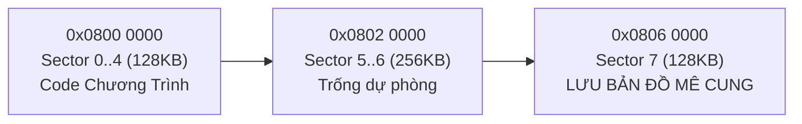

1. **1 viên Pin `LiPo 2S 350 mAh` chạy được bao nhiêu lượt?**
   - Tổng dòng tiêu thụ trung bình của cả xe (STM32 + 4 mắt IR băm xung + 2 motor N20 tải nhẹ ~95g) chỉ khoảng **`350 – 450 mA`**.
   - Thời gian chạy liên tục của 1 viên `2S 350 mAh` là:
     $$T = \frac{350\text{ mAh}}{400\text{ mA}} \times 60 \approx \mathbf{52\text{ phút chạy liên tục!}}$$
   - Mỗi lượt chạy mê cung chỉ mất **`6 – 25 giây`**. Nghĩa là **1 viên `LiPo 2S 350 mAh` sạc đầy chạy dư sức 40 – 60 lượt liên tiếp suốt cả buổi thi mà không cần thay pin!**
   - *(Lý do ta vẫn bắt buộc lưu Flash là để khi nhặt xe về `(0,0)`, bạn có thể **gạt tắt công tắc nguồn để lau sạch bụi bánh xe Silicone** theo Mục 4.2 hoặc bấm Reset mà không bị mất trắng bản đồ trong RAM).*
## 2. Tính Toán Thực Tế: Gá Bắt Ốc Motor, Đai Ốc M2 & Mối Hàn Chì

Bạn hỏi rất sát thực tế! Dưới đây là kích thước thật ngoài đời của bộ gá nhựa trắng **GA12-N20 Mounting Bracket** bán tại Hshop (`5.000đ/chiếc`) và cách lắp để **không cấn bánh, không chạm chập mối hàn**:

| Thành phần cơ khí thực tế | Kích thước thật | Ảnh hưởng nếu không tính trước | Giải pháp đã áp dụng vào thiết kế |
| :--- | :--- | :--- | :--- |
| **Gá nhựa trắng N20 (Hshop)** | Rộng **`25.4 mm`** (tâm 2 lỗ ốc cách nhau `18.0 mm`), cao **`11.4 mm`**, dày `8.6 mm` | Tai bắt ốc rộng gấp đôi thân motor (`12 mm`), dễ cấn sang dây cắm Encoder của motor bên kia | Tăng độ lệch tâm 2 trục lên **`Δz = 15.0 mm`** (`z = ±7.5 mm`) và đặt mặt hộp số ở `x = ±22.0 mm` $\rightarrow$ toàn bộ tai gá `25.4 mm` nằm gọn dưới PCB (`x = ±17.5 mm`) |
| **Đầu ốc & Tán `M2`** | Mũ ốc tròn `Ø3.8 mm` cao `1.1 mm` nằm mặt trên PCB; tán lục giác `4.0 mm` ngậm dưới đáy gá | Mũ ốc mặt trên có thể đội cấn đáy module `TB6612` hoặc `MP1584` nếu đặt đè lên lỗ ốc | Bố trí chéo: `TB6612` nằm góc Trước–Phải (`z = -15.5 mm`), `MP1584` nằm góc Sau–Trái (`z = +15.5 mm`) $\rightarrow$ né hoàn toàn cả 4 đầu ốc M2 |
| **Mối hàn chì xuyên lỗ (THT)** | Nhọn xuống dưới gầm mạch **`1.0 – 1.5 mm`** (nhất là 40 chân rào cái cắm Blackpill ở `x = ±7.62 mm`) | Đỉnh vỏ sắt motor N20 nằm ngay dưới bụng Blackpill; nếu bắt sát gá nhựa vào mạch thì khe hở chỉ còn `0.7 mm` $\rightarrow$ **mối hàn đâm thủng vào vỏ sắt motor gây chập mạch!** | **Bắt buộc làm 2 việc:** (1) Đệm **long-đen nhựa M2 dày `1.5 mm`** giữa đỉnh gá motor và gầm PCB (nâng khe hở vỏ motor lên `2.2 mm`); (2) Dán **1 lớp băng dính cách điện Kapton** (hoặc băng dính điện đen) lên lưng sắt 2 motor N20 |
| **Tổng bề ngang & Vòng quay** | Cả bánh + trục D `10 mm` + gá ốc = **`64.0 mm`** | Vẫn nhỏ hơn hành lang tường (`88.4 mm`) tới `24.4 mm` | Đường kính vòng quay chéo cả bánh `Ø21 mm` = **`Ø73.4 mm < 84.0 mm`** (dư an toàn **`10.6 mm`** so với khe trụ!) |

### 2.2. Thống Nhất Kiến Trúc Module 2 Tầng (2-Deck Shield) Cho Cả Perfboard & PCB — Xóa Sạch 100% Lỗi Cấn Gầm, Cấn Dây & Cấn Gyro `GY-521`
Khi lắp thật ngoài đời, có **3 bẫy không gian vật lý** mà nếu không đo kỹ tới từng `0.1 mm` sẽ bị cấn ngay khi hàn:
1. **Bẫy 1 — `GY-521 MPU6050` KHÔNG THỂ đặt lọt giữa 2 hàng rào cái `STM32 Blackpill`:**
   - Hai hàng chân `Blackpill` có khoảng cách tâm `6 × 2.54 = 15.24 mm`; trừ đi bề dày nhựa của 2 thanh rào cái (`2.50 mm`), **khe lọt lòng thực tế chỉ còn `12.74 mm`**.
   - Trong khi đó, module **`GY-521 MPU6050` thật rộng `15.7 – 15.8 mm` (`15.8 × 21.0 mm`)** kèm hàng kim 8 chân nhô cao $\rightarrow$ đặt chung dưới bụng `Blackpill` chắc chắn **cấn cứng mất `~3.0 mm` vào hai rào cái**!
2. **Bẫy 2 — Búi dây thực tế dưới gầm & quanh Gyro:**
   - **2 bộ cáp Motor + Encoder N20 (12 sợi):** Cắt ngắn cáp zin còn **`4.5 – 5.5 cm`**, khoét **2 khe luồn dây chữ nhật `3.2 × 5.8 mm`** xuyên qua Tầng 1 ngay cạnh đầu giắc `JST` (`x = ±13.0 mm, z = ∓9.5 mm`) để uốn vòng 6 sợi dây lên cắm vào **header `2×3` mặt trên Tầng 1**.
   - **Dây Pin `LiPo 2S` (`22AWG` + giắc đỏ `JST` + giắc cân bằng trắng `XH2.54`)** và **dây câu `30AWG` trên Perfboard:** Nếu nhét dưới gầm sẽ cọ vào bánh xe và đĩa từ Encoder; nếu cắm rào nối tầng ở giữa mạch sẽ đâm thẳng vào cạnh `GY-521`.
3. **Giải pháp cơ khí chuẩn DRC in mạch — Thống Nhất 100% Perfboard & PCB Về Cùng Một Kiến Trúc Module 2 Tầng (`42 mm << 125 mm` trần luật BTC):**
   - **Quy tắc vàng DRC khi vẽ PCB (KiCad / EasyEDA):** Mọi lỗ khoan chân rào cắm (`Female Header`) và chân linh kiện xuyên lỗ bắt buộc phải có **lề phíp FR4 bao quanh tối thiểu `≥ 1.2 – 1.5 mm`** (không vát góc mạch cắt lẹm vào chân rào cái làm chân hàn lơ lửng ngoài không khí!).
   - **Tầng 1 — Bo Nguồn, Công Suất & Cảm Biến (`55.2 × 69.6 mm`):** Mở rộng 2 cánh chéo ra `±27.6 mm` (vòng quay tối đa vẫn chỉ `Ø73.4 mm << 84.0 mm` khe trụ!) để ôm trọn `TB6612FNG` và `MP1584 (5V)` với lề phíp xanh dư `1.6 mm` mọi phía; mặt trên đặt **`GY-521 (15.8 × 21.0 mm)` nằm độc lập một mình ngay tâm quay `(0,0)`**.
   - **Cặp rào nối tầng `J1` (`2×4` = 8P ở mũi `z = -22.2 mm`) & `J2` (`2×7` = 14P ở đuôi `z = +24.4 mm`) + 4 trụ đồng `M2 × 14.8 mm`:** Nằm trọn bên trong phíp mạch và **cách xa cạnh `GY-521` tới `9.2 – 11.4 mm`**, giúp Tầng 2 cắm/rút khỏi Tầng 1 trong 10 giây như **Arduino Shield**!
   - **Tầng 2 — Bo Vi Điều Khiển, Pin & Giao Diện (`42.8 × 64.0 mm`, chỉ vát nhẹ góc `2.2 mm`):** Toàn bộ 40 chân rào cái `STM32 Blackpill` ở nửa trái nằm sâu trong mép mạch **`+2.6 mm`**; Nửa Phải dán Velcro giữ `LiPo 2S` + giắc `JST/XH2.54`; Mũi đặt `RV2 + 3 LED`, Đuôi đặt `Công tắc nguồn + DIP 4-bit + START/CAL + Buzzer` lộ thiên dễ bấm.
   - **Mẹo đặt mạch JLCPCB siêu tiết kiệm (0đ chi phí phát sinh):** Ghép **Tầng 1 (`55.2 × 69.6 mm`) + rãnh phay `2.0 mm` + Tầng 2 (`42.8 × 64.0 mm`) = đúng `100.0 × 69.6 mm` $\le$ `100 × 100 mm`** $\rightarrow$ Đặt **1 đơn duy nhất `~160.000đ` tại JLCPCB là nhận về đủ 5 bộ xe 2 tầng hoàn chỉnh**, giữ nguyên 100% thông số PID đã tinh chỉnh từ bản Perfboard!

> [!WARNING]
> **Tại sao Lượt 2 (Speed Run) bản trước bị đi xuyên tường và bài học code thực tế?**
> Trong bản trước, khi chạy Lượt 2 từ dữ liệu Flash, thuật toán Floodfill coi các ô **chưa từng đi qua (`visited == false`)** là không có tường (`walls = 0`), khiến xe rẽ tắt vào vùng tối chưa khám phá!
> **Quy tắc vàng khi code C cho xe thật:** Bạn phải lưu **cả 2 mảng** `known_walls[16][16]` **VÀ** `visited[16][16]` vào Flash. Ở Lượt 1 (Search Run), cho phép đi qua ô `visited == 0` để mở bản đồ; còn ở **Lượt 2 (Speed Run), bắt buộc chặn cứng mọi ô có `visited[r][c] == 0`** (chỉ tìm đường ngắn nhất bên trong hành lang đã được mắt IR xác thực 100%). Mình đã sửa chuẩn logic này trong file mô phỏng!

---

## 3. Cơ Chế Hoạt Động & Code C Lưu Bản Đồ Vào Flash `STM32F411CEU6`

### 3.1. Tại sao phải dùng Sector 7 của Flash?
Bên trong chip `STM32F411CEU6` có 2 vùng nhớ khác hẳn nhau:
1. **SRAM (`128 KB`):** Đọc/ghi cực nhanh từng byte nhưng **mất sạch dữ liệu ngay tích tắc khi mất điện** (tắt công tắc nguồn hoặc rút pin).
2. **Internal Flash (`512 KB`, địa chỉ `0x0800 0000` đến `0x0807 FFFF`):** Giữ dữ liệu vĩnh viễn hàng chục năm không cần điện. Bộ nhớ này được chia cố định thành **8 Sector**:
   - `Sector 0..3` (16 KB × 4), `Sector 4` (64 KB), `Sector 5..6` (128 KB × 2): Chứa **code chương trình C** của bạn (code Micromouse thường chỉ tốn `~35 – 60 KB`, tức chỉ nằm ở Sector 0..4).
   - **`Sector 7` (`128 KB` cuối cùng, từ `0x0806 0000` đến `0x0807 FFFF`):** Hoàn toàn trống! Ta dùng riêng Sector 7 này làm "ổ cứng mini" lưu bản đồ mê cung.



### 3.2. Đặc tính vật lý của bộ nhớ Flash STM32 cần nhớ
- **Đọc Flash:** Đọc trực tiếp bằng con trỏ C bình thường (`*(uint8_t*)0x08060000`), mất chưa tới `1 micro-giây`.
- **Ghi Flash:** Không thể ghi đè bit `0` thành bit `1` trực tiếp! Khi xóa trắng (`Erase`), toàn bộ Sector 7 biến thành `0xFF` (toàn bit `1`). Muốn lưu bản đồ mới, quy trình chuẩn của thư viện `STM32 HAL` gồm 4 bước (mất khoảng `0.8 – 1.2 giây`, nên **chỉ gọi hàm này khi xe đã đứng yên trong ô Đích hoặc về lại `(0,0)`**):
  1. `HAL_FLASH_Unlock()` — Mở khóa bảo vệ ghi.
  2. `HAL_FLASHEx_Erase()` — Xóa `FLASH_SECTOR_7` về `0xFF`.
  3. `HAL_FLASH_Program()` — Ghi `Magic Header (0xABCD2026)` + mảng `known_walls[16][16]` (256 byte) + mảng `visited[16][16]` (256 byte) + `Checksum`.
  4. `HAL_FLASH_Lock()` — Khóa lại chống nhiễu ghi nhầm.

### 3.3. Code C chuẩn (STM32CubeIDE HAL) copy dùng ngay
```c
#include "stm32f4xx_hal.h"
#include <string.h>
#include <stdbool.h>

#define MAZE_FLASH_ADDR   0x08060000U   // Đầu Sector 7 (STM32F411CEU6 512KB)
#define MAZE_MAGIC_KEY    0xABCD2026U   // Nhãn nhận biết đã có bản đồ hợp lệ

typedef struct {
    uint32_t magic;              // 4 bytes
    uint8_t  walls[16][16];      // 256 bytes: bit0=N, bit1=E, bit2=S, bit3=W
    uint8_t  visited[16][16];    // 256 bytes: 1 = đã đi qua, 0 = chưa biết
    uint32_t checksum;           // 4 bytes kiểm tra toàn vẹn dữ liệu
} MazeFlashData_t;               // Tổng = 520 bytes (chia hết cho 4 byte Word!)

static uint32_t Calc_Checksum(const MazeFlashData_t *p) {
    uint32_t sum = p->magic;
    const uint8_t *raw = (const uint8_t *)p->walls;
    for (int i = 0; i < 512; i++) {
        sum = (sum * 31U) + raw[i];
    }
    return sum;
}

// Gọi hàm này KHI XE ĐÃ DỪNG YÊN ở Ô Đích (7,7)-(8,8) hoặc khi về lại (0,0)
bool Flash_SaveMaze(const uint8_t walls[16][16], const uint8_t visited[16][16]) {
    MazeFlashData_t packet;
    packet.magic = MAZE_MAGIC_KEY;
    memcpy(packet.walls, walls, 256);
    memcpy(packet.visited, visited, 256);
    packet.checksum = Calc_Checksum(&packet);

    HAL_FLASH_Unlock();

    FLASH_EraseInitTypeDef eraseInit = {0};
    uint32_t sectorError = 0;
    eraseInit.TypeErase    = FLASH_TYPEERASE_SECTORS;
    eraseInit.VoltageRange = FLASH_VOLTAGE_RANGE_3; // STM32 chạy 3.3V (2.7V - 3.6V)
    eraseInit.Sector       = FLASH_SECTOR_7;
    eraseInit.NbSectors    = 1;

    if (HAL_FLASHEx_Erase(&eraseInit, &sectorError) != HAL_OK) {
        HAL_FLASH_Lock();
        return false;
    }

    // Ghi từng Word (4 bytes = 32-bit) vào Sector 7
    const uint32_t *src = (const uint32_t *)&packet;
    uint32_t words = sizeof(MazeFlashData_t) / 4;
    for (uint32_t i = 0; i < words; i++) {
        if (HAL_FLASH_Program(FLASH_TYPEPROGRAM_WORD, MAZE_FLASH_ADDR + i * 4U, src[i]) != HAL_OK) {
            HAL_FLASH_Lock();
            return false;
        }
    }

    HAL_FLASH_Lock();
    return true;
}

// Gọi hàm này ở đầu hàm main() khi gạt DIP Switch sang chế độ SPEED RUN
bool Flash_LoadMaze(uint8_t walls[16][16], uint8_t visited[16][16]) {
    const MazeFlashData_t *stored = (const MazeFlashData_t *)MAZE_FLASH_ADDR;
    if (stored->magic != MAZE_MAGIC_KEY) return false;
    if (stored->checksum != Calc_Checksum(stored)) return false;

    memcpy(walls, stored->walls, 256);
    memcpy(visited, stored->visited, 256);
    return true;
}
```
*(Lưu ý nhỏ: Để nút xóa trắng Flash trước lượt thi mới, bạn gán 1 tổ hợp DIP Switch + giữ nút `CAL` 2 giây gọi `HAL_FLASHEx_Erase` xóa Sector 7 là xong!)*

---

## 4. Cách Tự Build 4 Cặp Cảm Biến Hồng Ngoại (DIY IR) Chuẩn Thi Đấu

### 4.1. Phân biệt chân linh kiện (cực kỳ dễ nhầm nếu không đo trước!)
1. **Bóng phát hồng ngoại `IR333-A` (vỏ nhựa trong xanh nhạt, bước sóng `940 nm`):**
   - **Chân Dài = Anode (+)**; **Chân Ngắn (bên vát phẳng vỏ nhựa) = Cathode (-)**.
   - Điện áp rơi thuận $V_F \approx 1.2\text{V} - 1.4\text{V}$.
2. **Bóng thu Phototransistor `PT334-6B` (vỏ nhựa ĐEN tuyền lọc ánh sáng nhìn thấy):**
   - **CẢNH BÁO NGƯỢC ĐỜI:** Với đa số bóng thu `PT334-6B` / phototransistor vỏ đen 3mm–5mm: **Chân Ngắn (vát phẳng) lại là Collector (+ nối lên `3.3V`)**, còn **Chân Dài là Emitter (- nối vào chân `ADC` và trở kéo xuống `GND`)**!
   - **Cách kiểm tra 5 giây trên Breadboard:** Cấp `3.3V` vào chân nghi là Collector, chân kia nối qua trở `4.7 kΩ` xuống `GND`, lấy đồng hồ vạn năng đo áp trên trở `4.7 kΩ` rồi chĩa điều khiển TV (hoặc bật đèn IR) vào đầu bóng. Nếu áp vọt từ `~0.05V` lên `2.5V – 3.1V` là đúng chiều!

### 4.2. Gia công chống nhiễu ánh sáng chéo (Bí quyết sống còn!)
Nếu để trần bóng phát cạnh bóng thu, tia hồng ngoại sẽ chiếu ngang trực tiếp từ vỏ nhựa bóng phát sang bóng thu làm cảm biến lúc nào cũng báo "có tường" dù trước mặt trống trơn!
- **Bước 1:** Cắt ống co nhiệt màu đen đường kính `Ø5 mm` (hoặc `Ø4 mm` cho bóng 3mm) dài **`8 mm`**.
- **Bước 2:** Lồng ống co nhiệt bọc kín quanh thân **bóng thu `PT334-6B`**, để ống nhô vượt quá đỉnh tròn của bóng thu `~1.0 mm` làm "loa che nắng", hơ bật lửa cho ôm khít. Làm tương tự bọc thân sườn của **bóng phát `IR333-A`** (để hở đầu tròn bóng phát).
- **Bước 3:** Đặt bóng phát và bóng thu song song sát nhau (cách tâm `5.5 – 6.0 mm`), uốn chân vuông góc `90°` sao cho khi hàn dưới gầm mũi mạch, tâm 2 bóng nằm ở **độ cao `10 – 12 mm` so với mặt sàn** (chiếu trúng chính giữa bức tường trắng cao `20 mm` của BTC!).

### 4.3. Nguyên lý mạch & Khử sạch nhiễu đèn hội trường
- **Mạch phát (2 kênh MOSFET đóng cắt xung ngắn `80 µs`):**
  - Nhánh Trước (`PB12` điều khiển MOSFET `Q1`): Cấp `5.0V` $\rightarrow$ `R = 47 Ω` $\rightarrow$ Anode `IR_FL` $\rightarrow$ Cathode vào Drain `Q1` (và song song nhánh `R = 47 Ω` + `IR_FR` vào chung Drain `Q1`). Dòng xung mỗi bóng:
    $$I_{\text{LED}} = \frac{5.0\text{V} - 1.3\text{V}}{47\,\Omega} \approx \mathbf{78\text{ mA}}\quad (\text{rất khỏe nhưng chỉ bật } 80\,\mu\text{s mỗi } 1\text{ ms nên mát lạnh!})$$
  - Nhánh Chéo (`PB13` điều khiển MOSFET `Q2`): Tương tự cho 2 bóng chéo `IR_DL` và `IR_DR`.
- **Thuật toán trừ nền (Ambient Subtraction):**
  1. Khi `Q1` đang **TẮT** (`PB12 = 0`): Đọc ADC chân `PA0` được giá trị nền `adc_off` (do đèn tuýp/ánh nắng hội trường).
  2. Bật `PB12 = 1`, đợi `60 – 80 µs` cho phototransistor ổn định $\rightarrow$ Đọc lại `PA0` được `adc_on` $\rightarrow$ Tắt ngay `PB12 = 0`.
  3. Tín hiệu tường thực sự = **`ir_signal = adc_on - adc_off`**. Dù BTC bật hay tắt đèn sân khấu, kết quả gần như không đổi!

---

## 5. Bảng Nối Dây Chi Tiết Từng Chân Trên Breadboard 830 Lỗ (Giai Đoạn 1)

Để cắm không rối dây trên **Breadboard 830 lỗ** (gồm 63 cột đánh số `1 → 63`, rãnh giữa chia 2 nửa hàng lỗ `a-b-c-d-e` và `f-g-h-i-j`, kèm 2 thanh nguồn trên/dưới):

### 5.1. Quy ước 2 thanh nguồn dọc Breadboard (Bắt buộc phân biệt rõ!)
- **Thanh Nguồn TRÊN (`+` Đỏ trên / `-` Xanh trên):** Cấp **`+5.0V`** (từ chân `OUT+` mạch hạ áp `MP1584` **sau khi đã dùng đồng hồ vạn năng vặn biến trở đồng trên MP1584 ra đúng `5.00V`!**) và **`GND`**.
- **Thanh Nguồn DƯỚI (`+` Đỏ dưới / `-` Xanh dưới):** Cấp **`+3.3V`** (lấy từ chân `3V3` của `STM32 Blackpill`) và **`GND`**.
- **Nối thông `GND`:** Cắm 1 sợi dây đen nối thanh `-` (Xanh trên) với thanh `-` (Xanh dưới) để toàn mạch chung Mass (`GND`)!
- **Nguồn Động cơ `VM = 7.4V`:** **TUYỆT ĐỐI KHÔNG cắm `7.4V` vào 2 thanh nguồn dài** để tránh cắm nhầm cháy chip! Đi dây đỏ riêng từ cực `+` Pin 2S $\rightarrow$ Công tắc $\rightarrow$ Anode Diode `1N5819` $\rightarrow$ vạch trắng Cathode `1N5819` cắm thẳng vào cột chân `VM` của `TB6612FNG` và chân `IN+` của `MP1584`.

### 5.2. Vị trí cắm các Module lên rãnh giữa Breadboard
- **`STM32F411 Blackpill`:** Cắm vắt ngang rãnh giữa từ **Cột 5 đến Cột 24** (cổng USB-C quay sang trái).
- **`TB6612FNG`:** Cắm vắt ngang rãnh giữa từ **Cột 30 đến Cột 37**.
- **`MPU6050 (GY-521)`:** Cắm ở nửa trên (`hàng a`) từ **Cột 42 đến Cột 49**.

### 5.3. Bảng tra cứu nối dây từng sợi (Cắm đúng từng chân!)

| Nhóm | Từ Linh Kiện / Chân Nguồn | Đi Qua Linh Kiện Phụ (nếu có) | Nối Tới Chân Đích (`STM32F411` / Module) | Ghi chú kiểm tra |
| :--- | :--- | :--- | :--- | :--- |
| **1. Nguồn & Đo Pin** | Pin 2S `(+)` (7.4–8.4V) | Công tắc gạt $\rightarrow$ Diode `1N5819` (vạch trắng hướng về tải) | Chân `IN+` (`MP1584`) **và** chân `VM` (`TB6612`) | Kèm tụ hóa `330µF` cắm sát chân `VM` và `GND` của `TB6612` |
| | Pin 2S `(-)` | — | Thanh `GND` chung toàn mạch | Nối chung `IN-`, `OUT-` của `MP1584` |
| | `MP1584` chân `OUT+` (**5.0V**) | **Đo đồng hồ đúng 5.0V trước!** | Thanh `+5V` (Đỏ trên) $\rightarrow$ Chân **`5V`** của Blackpill | Nuôi STM32, LED IR và Buzzer |
| | Blackpill chân **`3V3`** | — | Thanh `+3.3V` (Đỏ dưới) | Nuôi `VCC` TB6612, MPU6050, Hall Encoder, Thu IR |
| | Nút sau Diode `1N5819` (7.4V) | Trở `22 kΩ` nối tiếp trở `10 kΩ` xuống `GND` | Điểm giữa 2 trở nối vào **`PB0`** (`ADC1_IN8`) | Khi pin đầy `8.4V`, chân `PB0` nhận `2.62V < 3.3V` an toàn |
| **2. Nạp Code SWD** | `ST-Link V2`: `SWDIO`, `SWCLK`, `GND` | — | Cụm 4 chân đuôi Blackpill: `DIO` (`PA13`), `CLK` (`PA14`), `GND` | Nếu đang cấp nguồn từ Pin/5V thì **KHÔNG cắm chân 3.3V của ST-Link** để tránh xung đột 2 nguồn! |
| **3. Cầu H TB6612** | `TB6612` chân `VCC` & `STBY` | — | Nối cả 2 lên thanh **`+3.3V`** | Quên nối `STBY` lên `3.3V` là motor đứng im! |
| | `TB6612` cả 3 chân `GND` | — | Thanh **`GND`** | — |
| | `TB6612` `PWMA`, `AIN1`, `AIN2` | — | Blackpill: **`PA8`**, **`PB14`**, **`PB15`** | Điều khiển tốc độ & chiều Motor Trái |
| | `TB6612` `PWMB`, `BIN1`, `BIN2` | — | Blackpill: **`PA9`**, **`PA10`**, **`PA12`** | Điều khiển tốc độ & chiều Motor Phải |
| | `TB6612` `AO1, AO2` / `BO1, BO2` | — | 2 dây nguồn Motor Trái (`M1, M2`) / Motor Phải | Nếu bánh quay ngược chiều mong muốn, chỉ cần đảo `AO1` với `AO2` |
| **4. Hall Encoder** | Cụm 6 dây Motor **Trái**: `VCC`, `GND`, `C1(A)`, `C2(B)` | — | `VCC` $\rightarrow$ **`+3.3V`** (**cấm cắm 5V!**), `GND` $\rightarrow$ `GND`, `C1` $\rightarrow$ **`PB4`**, `C2` $\rightarrow$ **`PB5`** | `TIM3` phần cứng tự đếm xung |
| | Cụm 6 dây Motor **Phải**: `VCC`, `GND`, `C1(A)`, `C2(B)` | — | `VCC` $\rightarrow$ **`+3.3V`**, `GND` $\rightarrow$ `GND`, `C1` $\rightarrow$ **`PB6`**, `C2` $\rightarrow$ **`PB7`** | `TIM4` phần cứng tự đếm xung |
| **5. Phát IR (×4)** | Blackpill **`PB12`** (Phát Trước) | Qua trở `100 Ω` vào chân **B** của `S8050` (hoặc **G** của `AO3400`) + trở `10 kΩ` từ B/G xuống `GND` | Chân **E/S** nối `GND`; Chân **C/D** hút dòng từ Cathode (-) của 2 LED `IR_FL` & `IR_FR` (mỗi LED có 1 trở **`47 Ω`** riêng nối lên **`+5V`**) | Cắm thêm 1 tụ hóa `330µF` giữa `+5V` và `GND` cạnh khu vực LED IR |
| | Blackpill **`PB13`** (Phát Chéo) | Qua trở `100 Ω` + trở xả `10 kΩ` tương tự sang transistor số 2 | Đóng cắt 2 LED chéo `IR_DL` & `IR_DR` (mỗi LED qua 1 trở **`47 Ω`** riêng lên **`+5V`**) | Không bao giờ nối chung 2 LED vào 1 điện trở duy nhất |
| **6. Thu IR (×4)** | 4 bóng `PT334-6B` (`FL, DL, DR, FR`) | Collector nối **`+3.3V`**; Emitter nối qua trở **`4.7 kΩ`** xuống `GND` | Điểm nút giữa Emitter và trở `4.7 kΩ` nối lần lượt vào **`PA0`**, **`PA1`**, **`PA2`**, **`PA3`** | 4 kênh `ADC1_IN0..3` |
| **7. Gyro & UI** | `MPU6050`: `VCC`, `GND`, `SCL`, `SDA` | — | `VCC` $\rightarrow$ **`+3.3V`**, `GND` $\rightarrow$ `GND`, `SCL` $\rightarrow$ **`PB8`**, `SDA` $\rightarrow$ **`PB9`** | Giao tiếp `I2C1` (400 kHz) |
| | Biến trở `RV2 (10kΩ)` | 2 chân bìa nối `+3.3V` và `GND` | Chân giữa (Wiper) nối vào **`PB1`** (`ADC1_IN9`) | Vặn tua-vít chỉnh tốc độ Speed Run |
| | `DIP Switch 4-bit` + 2 Nút nhấn | 1 bên chân nối chung xuống `GND` | Bên kia nối vào **`PA4, PA5, PA6, PA7`** (DIP) và **`PB10`** (`START`), **`PA15`** (`CAL`) | Bật `GPIO_PULLUP` nội trong code STM32 (không tốn trở ngoài!) |
| | Còi `Buzzer 5V` | Cực `(+)` nối `+5V`, cực `(-)` vào chân C/D của transistor số 3 | Chân B/G qua trở `1 kΩ` nối vào **`PB3`** | Kêu báo hiệu khi lưu Flash xong |

---

## 6. Cách Gia Công Tấm Perfboard Chữ Nhật `6×8 cm` (Giai Đoạn 2)

Bạn băn khoăn hoàn toàn đúng: **Perfboard bán ngoài tiệm đều là hình chữ nhật (`6×8 cm` hoặc `7×9 cm`), vậy làm sao ra được hình khung xe?**
Câu trả lời là: **Hoàn toàn cắt được trong 20 phút bằng dụng cụ cầm tay giá rẻ — và bạn KHÔNG CẦN mài cong tròn như PCB đặt xưởng, chỉ cần cắt thẳng vát góc đa giác (như Tab 2 trong mô phỏng mới)!**

### Bước 1: Mua đúng loại phíp (Quan trọng số 1!)
- Mua tấm **Phíp thủy tinh FR4 xanh lá đục lỗ 2 mặt mạ đồng xuyên lỗ kích thước `6 × 8 cm`** (`~12.000đ/tấm`, mua dư 3 tấm).
- **Tránh xa** tấm phíp giấy màu nâu vàng (Bakelite 1 mặt `5.000đ`) vì chất liệu giòn dễ gãy khi bắt ốc motor và chấm mỏ hàn quá 3 giây là bong tróc hết mắt đồng!

### Bước 2: Cắt thẳng thành khung đa giác `58 × 68 mm` có 2 hốc bánh lệch
1. Từ tấm chữ nhật `60 × 80 mm`, dùng bút lông dầu (Sharpie) và thước kẻ vạch theo đúng hàng lỗ `2.54 mm`:
   - Cắt bỏ `12 mm` chiều dài thừa để còn **`60 × 68 mm`**.
   - Kẻ **4 đường chéo vát góc `45°`** ở 4 góc tấm mạch (mỗi cạnh vát vào `12 mm` $\rightarrow$ loại bỏ hoàn toàn 4 góc nhọn để khi xoay `360°` không bao giờ chạm trụ!).
   - Kẻ **2 hốc hình chữ nhật lệch nhau** ở 2 bên hông cho 2 bánh xe lọt vào:
     - Hốc bánh Trái (nửa trước): sâu vào **`7 mm`** (từ mép ngoài vào), dài **`25 mm`**.
     - Hốc bánh Phải (nửa sau): sâu vào **`7 mm`**, dài **`25 mm`**.
2. **Cách cắt dễ nhất cho sinh viên không có máy CNC:**
   - Dùng **cưa lọng tay mini** (`~25.000đ` ở tiệm kim khí/Shopee) hoặc **kìm cắt chân linh kiện loại sắc (`Plato 170`)** bấm nối tiếp dọc theo hàng lỗ `2.54 mm` (vì hàng lỗ đã đục sẵn như đường rãnh tem thư nên cưa/bấm đi thẳng tắp rất nhẹ!).
   - Dùng **dũa sắt dẹt / dũa kim cương nhỏ (`15.000đ`)** hoặc giấy nhám `P240` liếc nhẹ 2 phút cho các cạnh phẳng mịn, không đứt tay.

> [!CAUTION]
> **An toàn sức khỏe bắt buộc khi cắt/dũa phíp FR4:** Bụi phíp xanh FR4 là **bụi sợi thủy tinh mịn**, hít vào rất hại phổi và dính lên da gây ngứa rát! Khi cưa và dũa, bạn **bắt buộc đeo khẩu trang**, lót tờ giấy ướt bên dưới (hoặc nhúng ướt mép mạch dưới vòi nước khi dũa) để bụi kết bết lại không bay lên không khí, làm xong rửa tay bằng nước lạnh + xà phòng.

### Bước 3: Khoét 2 khe luồn dây Encoder, khoan lỗ ốc `M2` & Ghép Module 2 Tầng Shield (Đồng Nhất 100% Với Bản PCB)
- **Cách khoét 2 khe chữ nhật `3.0 × 5.6 mm` trên tấm Perfboard Tầng 1 cho cáp Encoder:** Tại vị trí ngay cạnh đầu giắc `JST` của 2 motor (`x = ±11.2 mm, z = ∓9.5 mm`), dùng kìm cắt cạnh `Plato 170` bấm thông 3 lỗ đồng liền kề nhau rồi dũa nhẹ là tạo được khe chữ nhật gọn đẹp để luồn 6 sợi cáp Encoder lên mặt trên Tầng 1 mà không cần vòng dây ra mép ngoài xe!
- **Khoan 4 lỗ bắt gá motor & 4 lỗ trụ đồng:** Ướm 2 gá nhựa `GA12-N20` lệch nhau `15 mm` vào gầm Tầng 1 và đánh dấu 4 lỗ trụ đồng `M2 × 14.8 mm` ở 4 góc thoáng `(-10.2 mm, -23.0 mm)`, `(+12.0 mm, -23.0 mm)`, `(-11.8 mm, +23.8 mm)` và `(+12.0 mm, +23.8 mm)`. Dùng mũi khoan tay `Ø2.0 – 2.2 mm` mở rộng lỗ đồng có sẵn là bắt vừa ốc `M2`.
- **Phân tầng linh kiện & nối tầng qua cặp rào Shield `J1 / J2` (đạt chuẩn DRC 0% thò mép, 0% cấn `GY-521`):**
  - **Tầng 1 (Bo đáy `55.2 × 69.6 mm`):** Mặt dưới gắn 2 motor `GN20 6V 500RPM` + 4 cặp IR sát mũi + 3 chân trượt PTFE; mặt trên gắn **`MPU6050 (GY-521)` độc lập ngay tâm quay `(0,0)`**, `TB6612FNG` và `MP1584 (5V)` nằm gọn trong 2 cánh `±27.6 mm` (dư lề phíp `1.6 mm`).
  - **Cặp rào nối tầng `J1` (`2×4` = 8 chân ở đầu mũi `z = -22.2 mm`) & `J2` (`2×7` = 14 chân ở đuôi `z = +24.4 mm`):** Hàn rào đực trên Tầng 1 và rào cái `8.5 mm` dưới gầm Tầng 2 — nằm cách xa `GY-521` tới `9.2 – 11.4 mm`, hoàn toàn không che khuất hay cấn vào Gyro!
  - **Tầng 2 (Bo trên `42.8 × 64.0 mm`, chỉ bấm nhẹ góc `2.2 mm`):** Toàn bộ 40 chân rào cái `STM32 Blackpill` ở nửa trái nằm trọn bên trong phíp xanh (`+2.6 mm` lề an toàn); nửa phải dán Velcro giữ `LiPo 2S` + giắc `JST/XH2.54`; `RV2 + 3 LED` ở mũi và `Công tắc nguồn + DIP 4-bit + Nút nhấn + Buzzer` ở đuôi.
  - **Đi dây sạch tuyệt đối:** Hàn dây đồng bọc `30AWG` áp sát mặt dưới Tầng 2 nối về chân `J1/J2`, và đi men theo rìa ngoài mặt trên Tầng 1 từ `J1/J2` sang `TB6612`/`MP1584` $\rightarrow$ không một sợi dây nào vắt ngang qua `GY-521` hay thò xuống gầm chạm motor!

---

## 7. Bảng Tổng Hợp Giá Tiền Đầy Đủ Toàn Bộ Dự Án (Tại Hà Nội)

Bảng dưới đây đã cộng đầy đủ cả các vật tư phụ (ốc M2, long-đen, trụ đồng, phíp FR4, dây câu mạch, ống co nhiệt...) để nhóm dự trù quỹ chính xác không phát sinh bất ngờ:

| STT | Hạng mục linh kiện | Số lượng mua (đã tính dự phòng) | Đơn giá tham khảo | Thành tiền (VNĐ) | Nơi mua tiện nhất (Hà Nội / Online) |
| :-: | :--- | :-: | --: | --: | :--- |
| 1 | `STM32F411CEU6 Blackpill` (WeAct) | 1 | 150.000 | **150.000** | DKE / Linh Kiện Điện Tử 3M / Hshop |
| 2 | Mạch nạp `ST-Link V2` vỏ nhôm + cáp | 1 | 55.000 | **55.000** | Trần Quốc Hoàn / Đại Cồ Việt / Shopee |
| 3 | Động cơ `GN20 / GA12-N20 6V 500 RPM` (hộp số `1:30`) kèm sẵn Hall Encoder | 2 | 175.000 | **350.000** | Bán Linh Kiện (Hà Nội) / Hshop / Thế Giới IC |
| 4 | Gá nhựa bắt động cơ `GA12-N20` (`25.4mm`) | 2 (nên mua 3) | 5.000 | **15.000** | Mua kèm luôn tại Hshop |
| 5 | Bánh xe Silicone `Ø20–22mm` trục D `3mm` (hoặc in 3D mâm + lốp Mini-Z) | 1 cặp (nên có 2 cặp) | 45.000 | **90.000** | In 3D CLB Bách Khoa + lốp Mini-Z Shopee |
| 6 | Driver cầu H kép `TB6612FNG` | 2 (1 dự phòng) | 42.000 | **84.000** | Hshop / 84 Đại Cồ Việt |
| 7 | Cảm biến góc `MPU6050 (GY-521)` | 1 | 45.000 – 80.000 | **65.000** | Hshop / Tạ Quang Bửu |
| 8 | Mạch hạ áp xung `MP1584EN` (chỉnh về `5.0V`) | 2 | 18.000 | **36.000** | 84 Đại Cồ Việt / Trần Quốc Hoàn |
| 9 | Bộ mắt IR tự làm: `10× IR333-A` (940nm) + `10× PT334-6B` vỏ đen | 10 cặp | 3.500 / cặp | **35.000** | Thế Giới IC / Tạ Quang Bửu |
| 10 | MOSFET dán `AO3400` (10c) + Transistor cắm `S8050` (10c) | 1 gói mỗi loại | 15.000 | **30.000** | Thế Giới IC / Shopee |
| 11 | Gói điện trở `1/4W 1%` (`47Ω, 100Ω, 1kΩ, 4.7kΩ, 10kΩ, 22kΩ`) + trở dán `0805` | 6 trị số | 3.000 / tép | **25.000** | 84 Đại Cồ Việt / Tạ Quang Bửu |
| 12 | Biến trở tinh chỉnh `10kΩ` (`3296W` / `RM065`) + Tụ `330µF 16V` (5c) + Tụ `100nF` (10c) + Diode `1N5819` (5c) | 1 bộ | — | **30.000** | 84 Đại Cồ Việt / Thế Giới IC |
| 13 | Cụm UI: `DIP Switch 4-bit` (2c) + Nút `6×6mm` (5c) + Công tắc gạt SPDT (3c) + LED 3mm + Buzzer 5V | 1 bộ | — | **28.000** | Thế Giới IC / Đại Cồ Việt |
| 14 | Pin `LiPo 2S 7.4V 300–350mAh` + Sạc cân bằng `B3 2S/3S` + Jack `JST/PH2.0` | 2 viên pin + 1 sạc | 75k/pin + 85k sạc | **235.000** | Vua Mô Hình (Thái Hà) / Shopee |
| 15 | **Vật tư lắp ráp cơ khí & test mạch:** Breadboard 830 lỗ (`35k`), Dây cắm (`25k`), 3 tấm Perfboard FR4 2 mặt `6×8cm` (`36k`), Rào cái 40P (`10k`), Cuộn dây câu `30AWG` (`25k`), Ống co nhiệt đen `Ø5mm` (`5k`), Bộ ốc + tán + long-đen nhựa `M2` + trụ đồng + băng dính Kapton (`45k`) | Trọn bộ | — | **181.000** | Tạ Quang Bửu / Chợ Trời / Shopee |
| 16 | Đặt in PCB 2 lớp hoàn chỉnh (JLCPCB qua trung gian VN — 5 bo mạch) | 1 đơn (5 PCB) | ~160.000 | **160.000** | Đặt ở Giai đoạn 3 (tháng 1–2/2027) |
| | **TỔNG CỘNG TOÀN BỘ (Đủ làm từ Breadboard → Perfboard → PCB thi đấu)** | | | **~1.569.000 đ** | *(Chia nhóm 3–5 thành viên: ~315k–520k/bạn)* |
